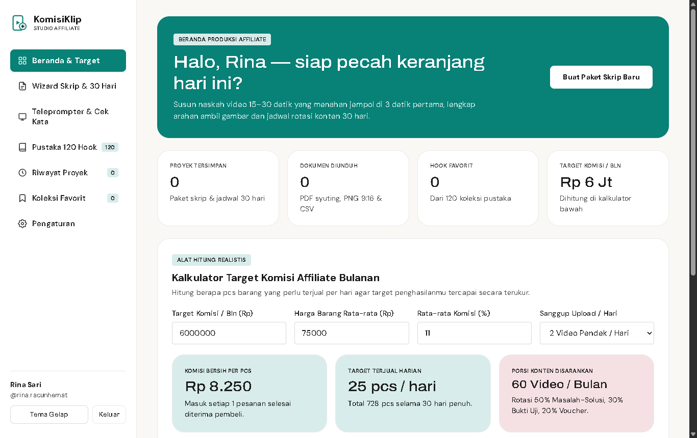
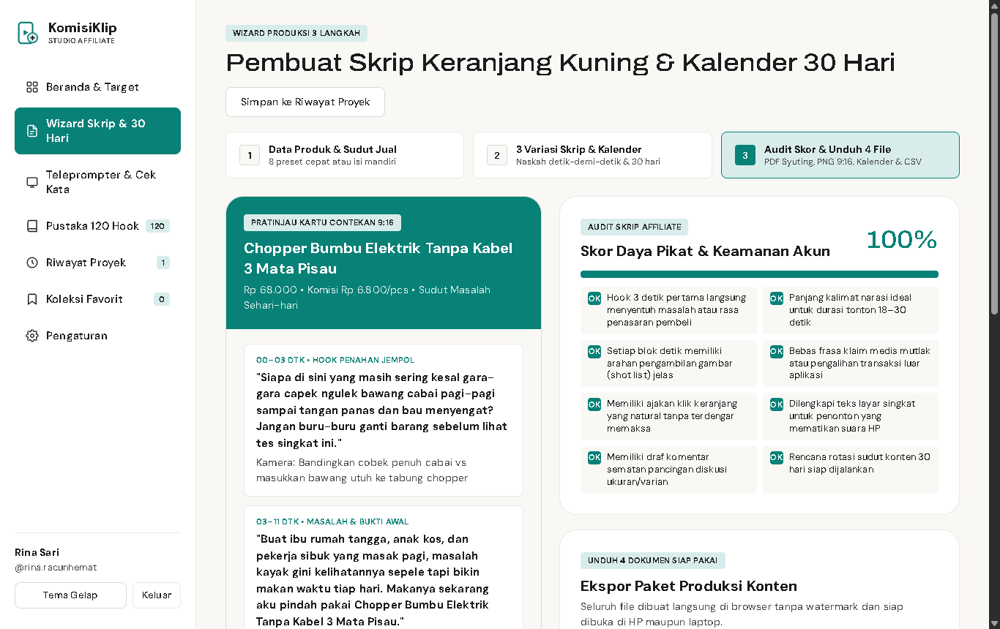
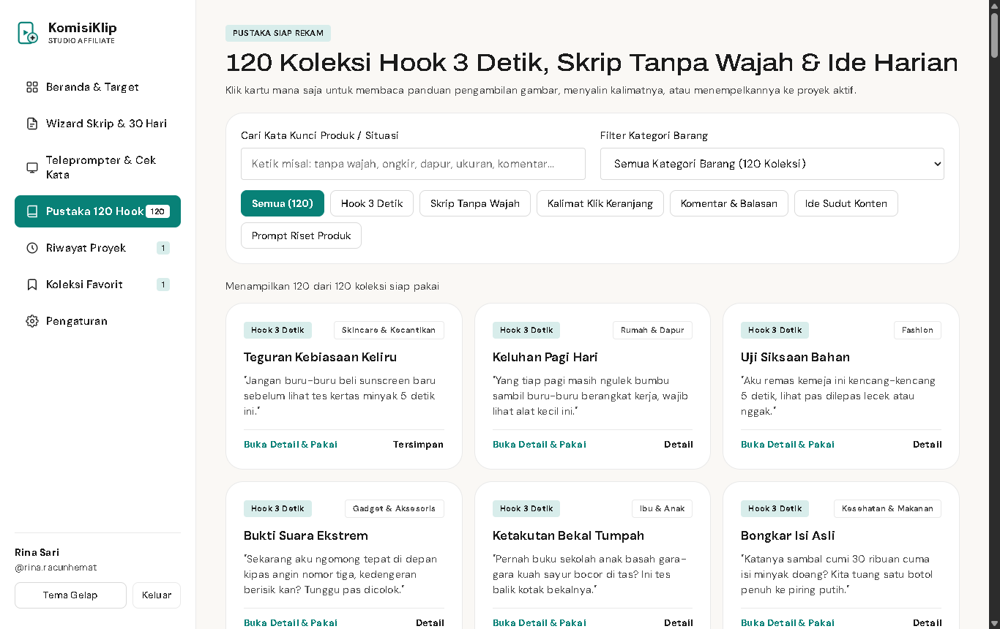
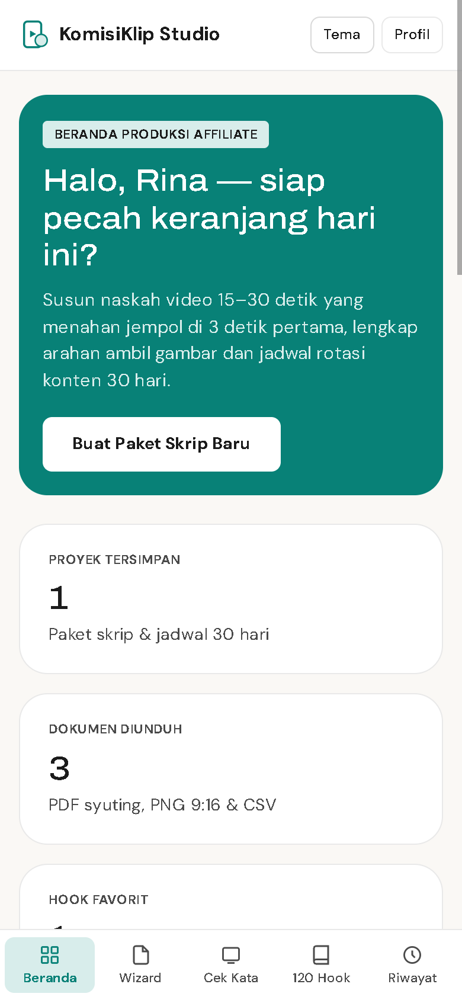

# SETOR PRODUK #6 — KomisiKlip Studio

## 1. Profil Produk & Usulan Harga
- **Nama Produk:** KomisiKlip Studio — Studio Skrip Keranjang Kuning & Jadwal Konten Affiliate TikTok / Shopee
- **Siapa Pembelinya:** Kreator affiliate pemula maupun aktif di TikTok Keranjang Kuning & Shopee Video, ibu rumah tangga, anak kos, pekerja sampingan, serta pemilik toko online di Indonesia yang rutin membuat video pendek promosi produk harian (termasuk yang malu tampil wajah di depan kamera).
- **Masalah Apa yang Diselesaikan:**
  1. Banyak kreator affiliate bengong lama di depan barang sampel karena bingung merangkai kalimat **3 detik pertama** supaya penonton tidak langsung geser layar (*skip*).
  2. Banyak yang canggung tampil muka di kamera, baru bikin 1–2 video untuk satu barang sudah kehabisan ide sudut bahasan, atau tidak sengaja memakai frasa klaim berlebihan yang menyebabkan jangkauan video dibatasi platform.
  3. Banyak pemula sudah terlanjur mengeluarkan Rp500.000–Rp1.200.000 membeli kelas/webinar affiliate yang isinya hanya rekaman teori panjang, padahal yang dibutuhkan malam ini adalah naskah siap baca, contekan syuting HP, dan kalender konten sebulan penuh.
- **Harga Jual yang Diusulkan:** **Rp99.000** (sekali bayar untuk akses penuh aplikasi web seumur hidup, tanpa biaya langganan bulanan & berjalan 100% mandiri di browser tanpa kuota API berbayar).

---

## 2. Link Live (Cloudflare Pages)
- **Link Landing Page (LP Jualan):** [https://nifari-affiliate-konten-lp.pages.dev](https://nifari-affiliate-konten-lp.pages.dev)
- **Link Web App (Aplikasi Pembeli):** [https://nifari-affiliate-konten-app.pages.dev](https://nifari-affiliate-konten-app.pages.dev)
  - *Cara masuk cepat untuk penguji:* Klik tombol **Isi Cepat Akun Contoh Pembeli** di halaman masuk (atau masukkan kode lisensi `KOMISI-2026-PRO`), lalu klik **Masuk ke KomisiKlip Studio**.

---

## 3. Tangkapan Layar Aplikasi (3 Desktop + 1 HP)

### Desktop 1 — Beranda Produksi & Kalkulator Target Komisi Affiliate Bulanan

### Desktop 2 — Wizard Langkah 3: Audit Skor Kesiapan Skrip, Pratinjau 9:16 & Ekspor 4 Dokumen Nyata

### Desktop 3 — Pustaka 120 Hook 3 Detik, Skrip Tanpa Wajah, Kalimat Keranjang & Ide Harian

### Tampilan HP (Lebar 390px) — Navigasi Bawah Rapi, Kartu Editorial Bersih & Tanpa Geser Samping

*(Tangkapan layar tambahan juga tersimpan di folder `./screenshots/`: `01-login-desktop.png` untuk Layar Akses Lisensi Pembeli dan `04-teleprompter-cekkata-desktop.png` untuk Pemindai Kata Rawan Pelanggaran & Layar Teleprompter Kamera).*

---

## 4. Apa yang Sudah Dites & Hasilnya

Seluruh pengujian dijalankan menggunakan browser **Google Chrome asli** pada ukuran layar Desktop (`1366×860`) dan HP (`390×844`):

| Bagian yang Dites | Skenario Pengujian | Hasil |
| :--- | :--- | :--- |
| **Login Lisensi Pembeli** | Masuk memakai nama kreator, username `@handle`, email, & kode lisensi (`KOMISI-2026-PRO`) serta tombol akun contoh | **Lulus** — Sesi tersimpan rapi di browser dan langsung membuka Beranda KomisiKlip Studio. |
| **Kalkulator Target Komisi** | Ubah target komisi bulanan (`Rp9.000.000`), harga barang, persentase komisi, & frekuensi upload lalu kirim ke Wizard | **Lulus** — Komisi per pcs, target penjualan harian, dan porsi konten terhitung otomatis serta tersinkron ke Wizard. |
| **Wizard 3 Langkah & Kalender 30 Hari** | Pilih 1 dari 8 preset kategori barang laris → susun 3 variasi skrip berdetik & jadwal rotasi 30 hari → cek audit 8 kriteria | **Lulus** — Tersusun 3 variasi skrip detik-demi-detik, caption, tagar, komentar sematan, 30 jadwal harian, dan skor kesiapan `100%`. |
| **Ekspor Lembar Syuting (`.pdf`)** | Klik unduh Lembar Syuting 3 Variasi Skrip | **Lulus** — Menghasilkan dokumen PDF A4 multi-halaman asli (`8,8 KB`, header `%PDF-1.4`) berisi 3 variasi skrip & arahan kamera. |
| **Ekspor Kartu Contekan HP 9:16 (`.png`)** | Klik unduh Kartu Contekan HP 9:16 | **Lulus** — Menghasilkan gambar potret tajam `1080×1920 px` (`143,4 KB`, header PNG asli) siap simpan ke galeri HP. |
| **Ekspor Kalender 30 Hari (`.pdf`) & Pelacak (`.csv`)** | Klik unduh Kalender 30 Hari PDF & Tabel Pelacak Komisi CSV Excel | **Lulus** — Menghasilkan PDF 30 hari utuh (`16,1 KB`, `%PDF-1.4`) dan file spreadsheet `.CSV` ber-UTF-8 BOM (`14,1 KB`) siap buka di Excel/Google Sheets. |
| **Pemindai Kata Rawan & Teleprompter** | Muat contoh naskah penuh klaim medis/order WA → pindai risiko → klik ganti otomatis ke kalimat aman & uji gulir layar baca | **Lulus** — Seluruh frasa rawan terdeteksi akurat dan langsung berubah menjadi kalimat promosi yang aman bagi akun kreator. |
| **Pustaka 120 Koleksi Affiliate** | Filter 6 kategori, filter 7 kategori produk, pencarian kata kunci, buka modal detail, simpan favorit, & tempel ke skrip | **Lulus** — Seluruh **120 item** tampil utuh lengkap arahan kamera visual dan tips menahan penonton. |
| **Sistem Desain (`DESIGN.md`)** | Audit warna Canvas Warmth `#faf8f5`, Deep Teal `#088177`, Surface White `#ffffff`, Ink `#1b1b1b`, font `Archivo` extended + `DM Sans`, sudut kartu `24px`, tombol `8px`, input `4px`, tanpa *box-shadow* & tanpa emoji | **Lulus** — 100% sesuai spesifikasi *N26 Deep Ocean Teal Design Reference* baik di Web App maupun Landing Page. |
| **Landing Page (`< 1 MB`)** | Cek ukuran file tunggal (`530,7 KB`), 12 bagian berurutan, simulator skrip bergerak di Hero, & Demo unduh contekan `.PNG` asli | **Lulus** — Ukuran setengah dari batas 1 MB, seluruh 5 gambar WebP termuat penuh, demo unduhan PNG 9:16, checkout, & FAQ berfungsi mulus. |
| **Responsif HP (`390px`) & Console** | Cek `document.documentElement.scrollWidth` di semua layar App & LP serta pantau error console/runtime | **Lulus** — `scrollWidth = 390px` tepat di semua tampilan tanpa *horizontal scroll* dan **0 error** di console baik pada Web App maupun Landing Page. |
