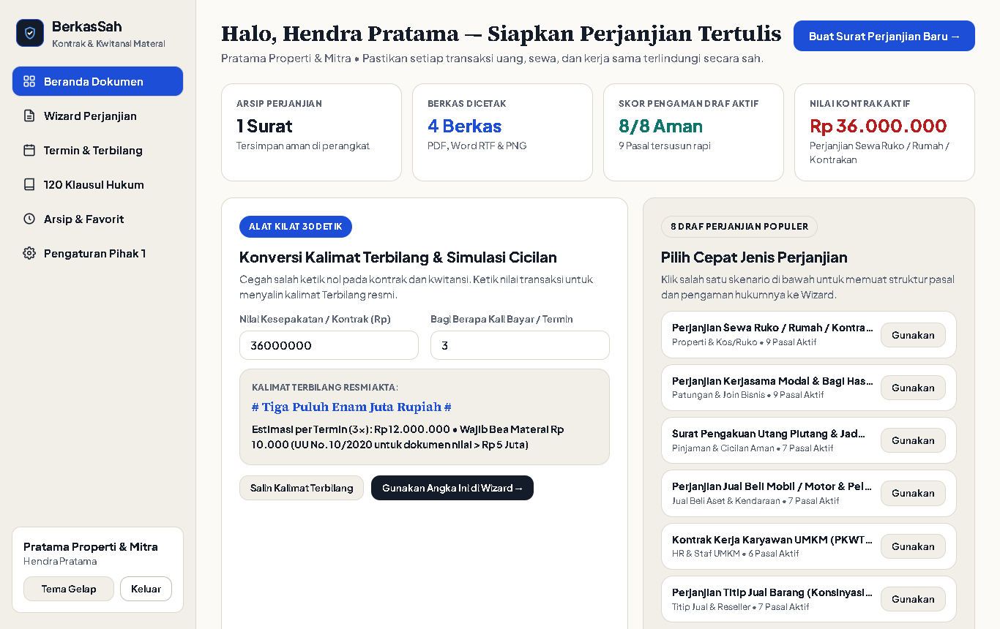
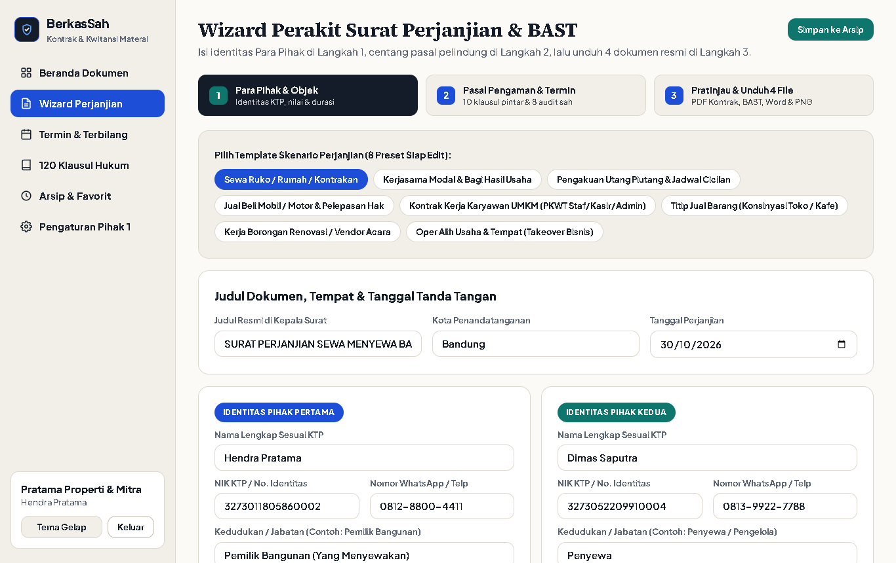
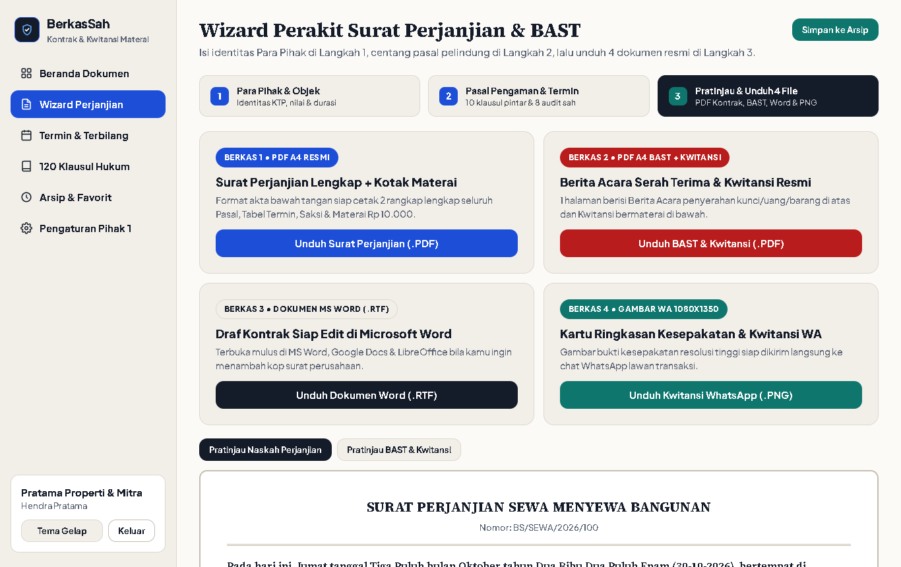
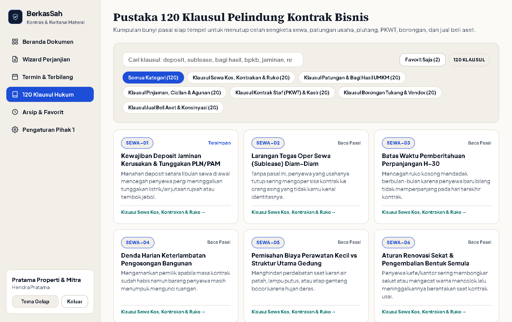
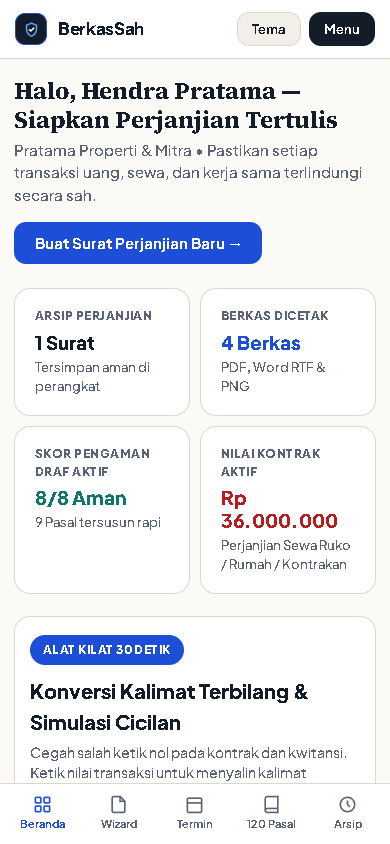

# SETOR PRODUK #10 — BerkasSah Studio

## 1. Identitas Produk
- **Nama Produk:** BerkasSah Studio — Generator Surat Perjanjian Resmi Bawah Tangan, Kontrak Sewa/Bisnis, Berita Acara Serah Terima (BAST) & Kwitansi Materai Rp 10.000
- **Siapa Pembelinya:** Pemilik ruko/kontrakan/kos, pelaku UMKM yang sedang patungan usaha atau bagi hasil, pemberi pinjaman cicilan & penjual kendaraan bekas, pemilik toko/kafe yang mempekerjakan staf kasir/admin (PKWT), pengguna jasa tukang borongan renovasi, serta supplier titip jual (konsinyasi) di Indonesia.
- **Masalah yang Diselesaikan:**
  1. Melepas kunci ruko/kontrakan, modal patungan puluhan juta, atau pinjaman uang hanya bermodal rasa sungkan dan chat WhatsApp tanpa bukti tertulis bermaterai dan saksi KTP yang sah.
  2. Comot draf kontrak seadanya dari internet yang bolong pasal krusialnya — lupa mengatur uang deposit jaminan tunggakan PLN/PAM, larangan oper sewa (*sublease*) diam-diam, pemisahan rekening usaha, denda harian, hingga retensi garansi tukang `5%`.
  3. Rawan salah ketik nol atau selisih antara angka nominal dan ejaan huruf kalimat Terbilang Rupiah pada surat perjanjian maupun kwitansi tanda terima.
  4. Biaya jasa pembuatan draf kontrak satuan di konsultan yang mencapai `Rp 1.500.000 – Rp 3.000.000` per satu surat, padahal pelaku UMKM membutuhkan banyak jenis dokumen sehari-hari.
- **Harga yang Diusulkan:** **Rp 149.000** (sekali bayar untuk selamanya, `100%` mandiri berbasis mesin aturan deterministik tanpa ketergantungan AI / tanpa API key / tanpa biaya bulanan, `100%` privat di browser pengguna).

## 2. Tautan Produksi (Cloudflare Pages)
- **Landing Page (LP):** https://nifari-berkassah-lp.pages.dev
- **Web App (Studio):** https://nifari-berkassah-app.pages.dev

## 3. Tangkapan Layar Aplikasi (Desktop `1366x860` & Mobile `390x844`)

### Desktop 1 — Beranda Dokumen, Skor Keabsahan & Konverter Terbilang Kilat 30 Detik

### Desktop 2 — Wizard Langkah 1 (8 Preset Skenario Kontrak, Identitas KTP Para Pihak & Saksi)

### Desktop 3 — Wizard Langkah 3 (Pratinjau Akta Bawah Tangan & Mesin Cetak 4 Format Dokumen)

### Desktop 4 — Pustaka 120 Klausul Hukum Pelindung Bisnis (6 Kategori Siap Tempel)

### Mobile HP (`390x844`) — Navigasi Tab Bawah Responsif Tanpa Geser Samping

## 4. Ringkasan Pengujian & Hasil Verifikasi Browser Asli (Google Chrome + Playwright)

| Komponen yang Diuji | Metode & Skenario Uji | Hasil Aktual | Status |
|---|---|---|---|
| **Gerbang Lisensi SHA-256 (`#login-form`)** | Uji penolakan kode salah, uji akses cepat pengembang dengan kolom kosong, uji lisensi pembeli lengkap, dan sesi `localStorage` | Kode salah ditolak rapi; sesi valid terbuka mulus dan tersimpan di browser | LULUS |
| **Sistem Desain Executive Legal Folio** | Audit tipografi `Source Serif 4` + `Plus Jakarta Sans`, palet Alabaster/Oxford/Seal Blue, mode terang & gelap, dan cek karakter emoji | Kontras tajam, mode gelap berfungsi mulus, `0` karakter emoji di seluruh UI | LULUS |
| **Mesin Terbilang Rupiah, Tanggal Hukum & Termin** | Uji konversi nominal jutaan–miliaran ke kalimat Terbilang baku, pembagian tahap termin, dan pengingat Bea Materai Rp 10.000 (UU No. 10/2020) | Ejaan Terbilang, kalimat pembuka tanggal hukum, dan tabel jatuh tempo akurat instan | LULUS |
| **Perakit Pasal Pintar & 8 Poin Audit Keabsahan** | Uji 8 preset perjanjian, centang/lepas 10 klausul pelindung, dan cek penomoran urut Pasal otomatis serta skor audit `8/8` | Nomor urut Pasal beradaptasi tanpa lompat nomor; indikator Pasal 1320/1338 KUHPerdata akurat | LULUS |
| **Ekspor 1 — Surat Perjanjian Lengkap (`.PDF` A4)** | Unduh dari Langkah 3 (`Surat-Perjanjian-perjanjian-sewa-ruko-rumah-kontrakan.pdf`) | File `%PDF-1.4` multi-halaman asli (`11.951 bytes`), lengkap tabel termin, saksi & kotak Materai Rp 10.000 | LULUS |
| **Ekspor 2 — BAST & Kwitansi Resmi (`.PDF` A4)** | Unduh lampiran Berita Acara Serah Terima + Kwitansi bermaterai 1 lembar | File `%PDF-1.4` asli (`4.142 bytes`), lengkap garis potong & kotak Materai Rp 10.000 | LULUS |
| **Ekspor 3 — Draf Kontrak MS Word (`.RTF`)** | Unduh dokumen Rich Text Format asli siap tambah kop surat di MS Word / Google Docs | File `{\rtf1` asli (`6.247 bytes`), terbuka mulus tanpa peringatan error ekstensi | LULUS |
| **Ekspor 4 — Kartu Ringkasan & Kwitansi WA (`.PNG`)** | Render HTML5 Canvas `1080x1350` resolusi tinggi siap kirim ke chat WhatsApp | File PNG asli (`82.599 bytes`, header `89504e47`), teks proporsional dan tajam | LULUS |
| **Pustaka 120 Klausul Hukum Bisnis (6 Kategori)** | Filter 6 kategori x 20 klausul, cari kata kunci, salin/sisipkan ke kontrak, dan tutup modal via tombol `Escape` | Tepat `120` klausul tampil tanpa AI; sisip pasal & tutup `Escape` berjalan mulus | LULUS |
| **Landing Page Tunggal (`lp/index.html`)** | Verifikasi ukuran total file, 12 bagian wajib, demo perakit pasal live + unduh Sampel Kwitansi PNG, dan `#checkoutForm` | Ukuran total `301,6 KB` (`< 1 MB`), demo interaktif & unduh sampel PNG berjalan mulus | LULUS |
| **Responsivitas HP (`390x844`) & Console Bersih** | Cek `document.documentElement.scrollWidth` di seluruh halaman App, Stepper Wizard & LP serta pantau console browser | `scrollWidth === 390` di semua tampilan; `0` console error / page error | LULUS |
