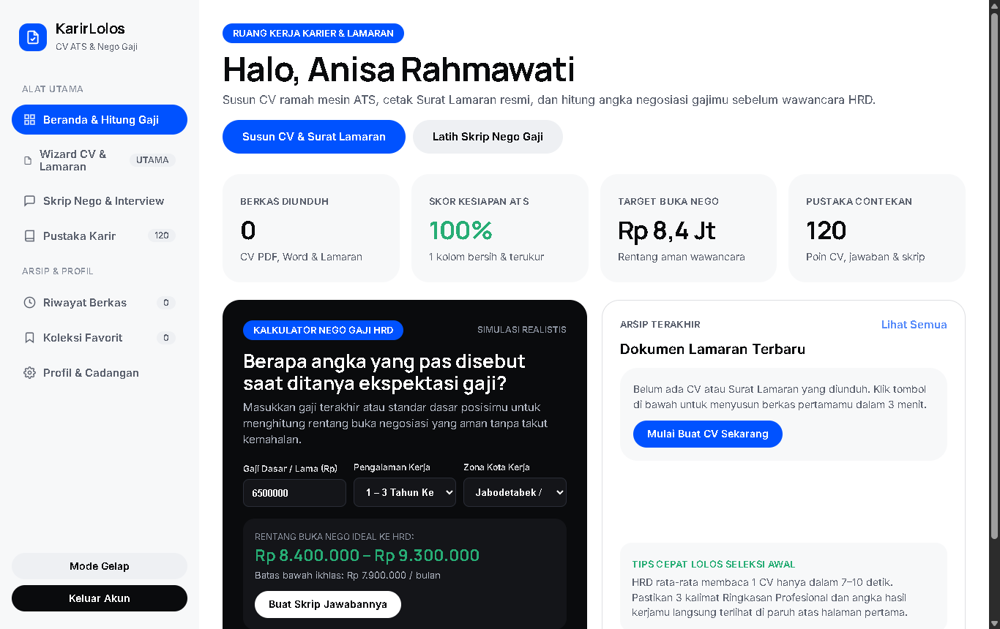
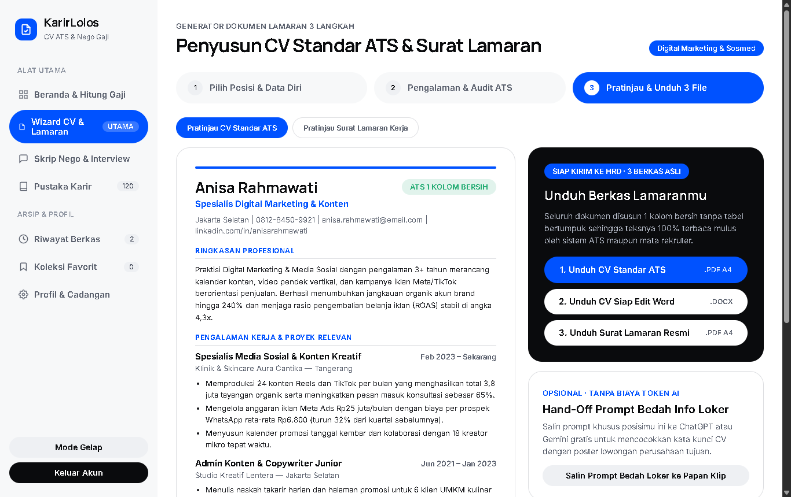
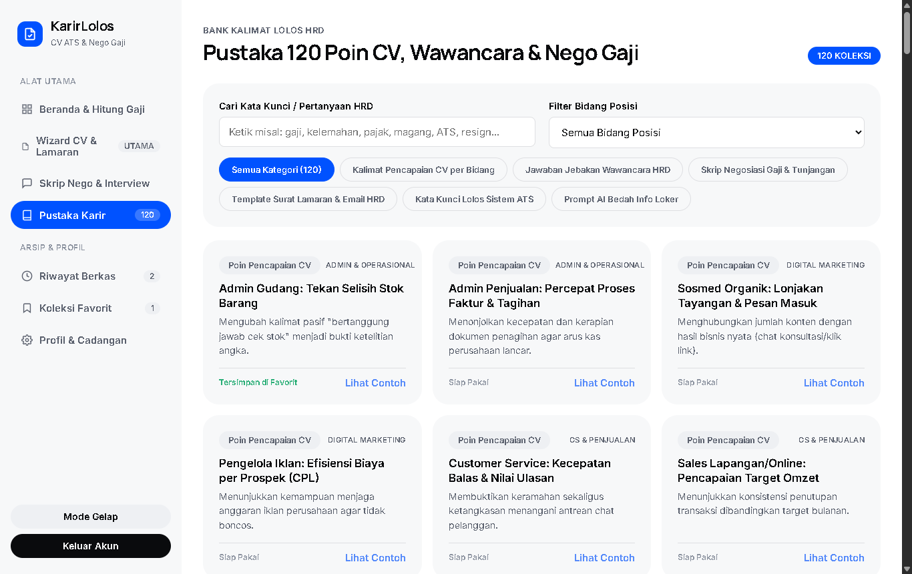
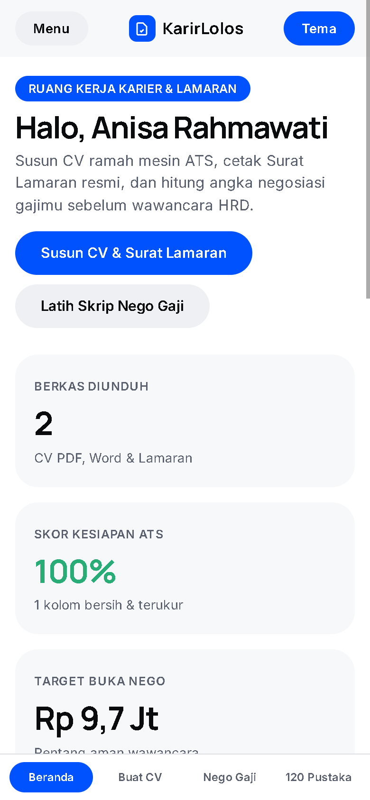

# SETOR PRODUK #5 — KarirLolos Studio

## 1. Profil Produk & Usulan Harga
- **Nama Produk:** KarirLolos Studio — Pembuat CV Lolos Seleksi HRD & Panduan Nego Gaji
- **Siapa Pembelinya:** Pencari kerja aktif, lulusan baru (*fresh graduate*), pekerja yang ingin pindah bidang karier (*career switcher*), serta karyawan staf hingga supervisor di Indonesia yang ingin melamar ke perusahaan baru dengan kenaikan gaji terukur.
- **Masalah Apa yang Diselesaikan:**
  1. Banyak pelamar gagal dipanggil wawancara bukan karena kurang mampu, melainkan karena memakai template CV dua kolom penuh ikon/tabel yang gagal dibaca sistem penyaring HRD (ATS) serta hanya menulis daftar tugas harian tanpa angka pencapaian.
  2. Ketika HRD bertanya *"Berapa ekspektasi gaji Anda?"* atau menawar di bawah harapan, pelamar sering gugup dan menjawab *"terserah standar perusahaan"* sehingga kehilangan potensi selisih gaji jutaan rupiah per tahun.
  3. Banyak pencari kerja enggan atau kecewa mengeluarkan Rp500.000–Rp1.500.000 untuk kelas/webinar karier yang hanya berisi video teori berjam-jam, padahal yang dibutuhkan malam ini adalah dokumen CV rapi, surat lamaran resmi, dan contekan skrip negosiasi gaji siap pakai.
- **Harga Jual yang Diusulkan:** **Rp99.000** (sekali bayar untuk akses penuh aplikasi web seumur hidup, tanpa biaya langganan bulanan & berjalan 100% mandiri di browser tanpa kuota API berbayar).

---

## 2. Link Live (Cloudflare Pages)
- **Link Landing Page (LP Jualan):** [https://nifari-cv-lolos-kerja-lp.pages.dev](https://nifari-cv-lolos-kerja-lp.pages.dev)
- **Link Web App (Aplikasi Pembeli):** [https://nifari-cv-lolos-kerja-app.pages.dev](https://nifari-cv-lolos-kerja-app.pages.dev)
  - *Cara masuk untuk pembeli & penguji:* Masukkan Kode Akses resmi yang diterima setelah konfirmasi pembelian pada layar masuk, lalu klik **Masuk ke KarirLolos Studio** (belum punya kode dapat mencoba generator sampel CV di Landing Page terlebih dahulu).

---

## 3. Tangkapan Layar Aplikasi (3 Desktop + 1 HP)

### Desktop 1 — Beranda Studio & Kalkulator Target Nego Gaji

### Desktop 2 — Wizard Langkah 3: Audit Skor Kesiapan ATS, Pratinjau A4 & Ekspor 3 Dokumen Lamaran

### Desktop 3 — Pustaka 120 Kalimat Pencapaian CV, Jawaban Wawancara HRD & Skrip Nego Gaji

### Tampilan HP (Lebar 390px) — Navigasi Bersih, Kartu Proporsional & Tanpa Geser Samping

*(Tangkapan layar tambahan juga tersimpan di folder `./screenshots/`: `01-login-desktop.png` untuk Layar Akses Lisensi Pembeli dan `04-nego-gaji-desktop.png` untuk Studio Skrip Nego Gaji & Jawaban Wawancara HRD).*

---

## 4. Apa yang Sudah Dites & Hasilnya

Seluruh pengujian dijalankan menggunakan browser **Google Chrome asli** pada ukuran layar Desktop (`1366×860`) dan HP (`390×844`):

| Bagian yang Dites | Skenario Pengujian | Hasil |
| :--- | :--- | :--- |
| **Login Lisensi Pembeli** | Masuk memakai nama pelamar, email, & kode akses resmi terverifikasi SHA-256 | **Lulus** — Validasi hash berjalan ketat tanpa bocoran kode di kode sumber, dan sesi tersimpan rapi membuka Beranda KarirLolos Studio. |
| **Kalkulator Target Nego Gaji** | Hitung rentang gaji ideal dari gaji saat ini/standar UMK, target kenaikan, pengalaman, & tunjangan lalu kirim ke Wizard | **Lulus** — Rentang buka negosiasi, batas aman penerimaan, dan selisih tahunan langsung terhitung serta tersinkron ke Studio Nego Gaji. |
| **Wizard CV 3 Langkah & Skor ATS** | Pilih 1 dari 8 preset posisi kerja → isi pengalaman berangka terukur & keahlian → cek Skor Kesiapan ATS & pratinjau A4 | **Lulus** — Indikator audit memeriksa 8 kriteria keterbacaan ATS secara *real-time* (mencapai `100%`) lengkap pratinjau CV & Surat Lamaran. |
| **Ekspor CV ATS-Friendly (`.pdf`)** | Klik unduh CV ATS-Friendly PDF | **Lulus** — Menghasilkan dokumen PDF A4 satu kolom teks asli yang dapat diseleksi mesin ATS (`4,3 KB`, header `%PDF-1.4`). |
| **Ekspor CV Editable Word (`.docx`)** | Klik unduh CV Format Word | **Lulus** — Menghasilkan dokumen OOXML `.docx` asli (`7,6 KB`, header `PK`) yang rapi dibuka dan diedit di Microsoft Word maupun Google Docs. |
| **Ekspor Surat Lamaran (`.pdf`)** | Klik unduh Surat Lamaran Kerja PDF | **Lulus** — Menghasilkan dokumen Surat Lamaran Kerja formal Bahasa Indonesia berformat PDF A4 (`4,4 KB`, header `%PDF-1.4`). |
| **Studio Nego Gaji & Wawancara HRD** | Uji 6 skenario negosiasi (ditanya ekspektasi gaji, ditawar di bawah angka aman, *fresh graduate*, pindah bidang, dll.) | **Lulus** — Nama pelamar, posisi tujuan, nama perusahaan, dan rentang nominal gaji otomatis menyatu ke skrip lisan maupun pesan tertulis siap salin. |
| **Pustaka 120 Koleksi Karier** | Filter 6 kategori, filter 8 bidang profesi, pencarian kata kunci, modal detail, simpan favorit, & tempel ke CV | **Lulus** — Seluruh **120 item** tampil utuh lengkap konteks HRD, kalimat siap pakai, dan tips wawancara. |
| **Sistem Desain (`DESIGN (1).md`)** | Audit warna Coinbase Blue `#0052ff`, Pure White `#ffffff`, Midnight `#0a0b0d`, Frost `#f7f8f9`, font `Manrope` + `Inter`, sudut kartu `24px`, tombol utama `56px`, pil `100000px`, tanpa *box-shadow* & tanpa emoji | **Lulus** — 100% sesuai spesifikasi *Coinbase Spain Design Reference* baik di Web App maupun Landing Page. |
| **Landing Page (`< 1 MB`)** | Cek ukuran file tunggal (`546,1 KB`), 12 bagian berurutan, pemindai ATS interaktif di Hero, & Demo unduh sampel CV `.PDF` | **Lulus** — Ukuran jauh di bawah batas 1 MB, seluruh 5 gambar WebP termuat penuh, kalkulator demo, unduhan PDF sampel, checkout, & FAQ berjalan mulus. |
| **Responsif HP (`390px`) & Console** | Cek `document.documentElement.scrollWidth` di semua layar App & LP serta pantau error console/runtime | **Lulus** — `scrollWidth = 390px` tepat di semua tampilan tanpa *horizontal scroll* dan **0 error** di console baik pada Web App maupun Landing Page. |
