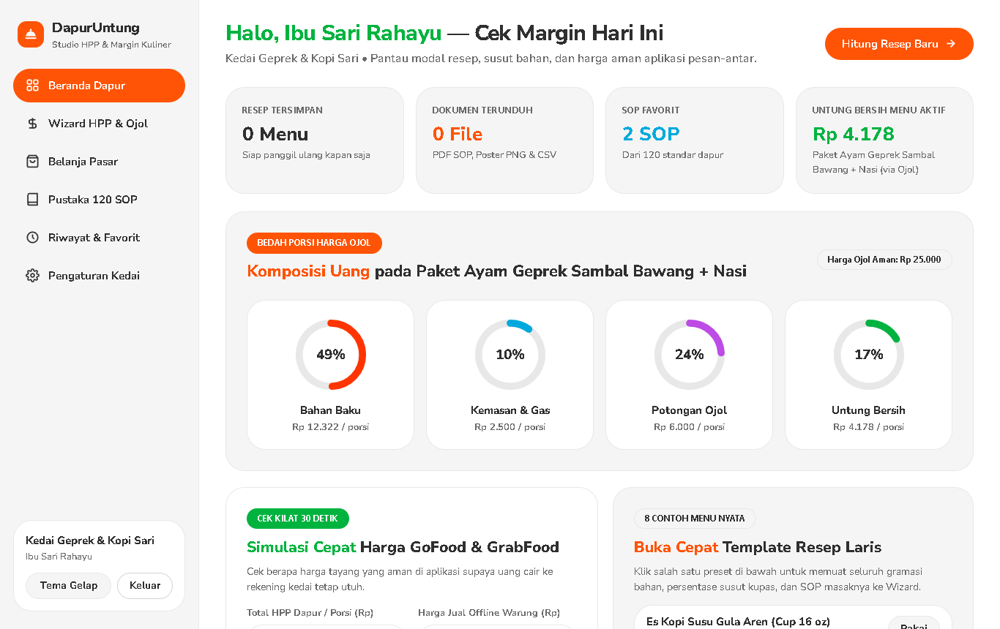
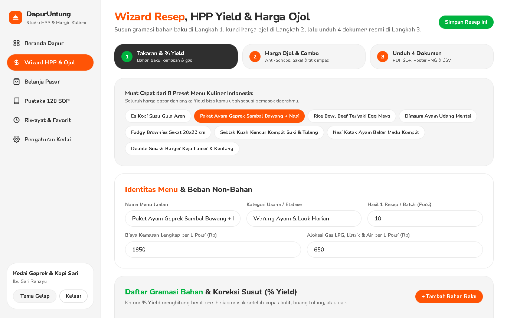
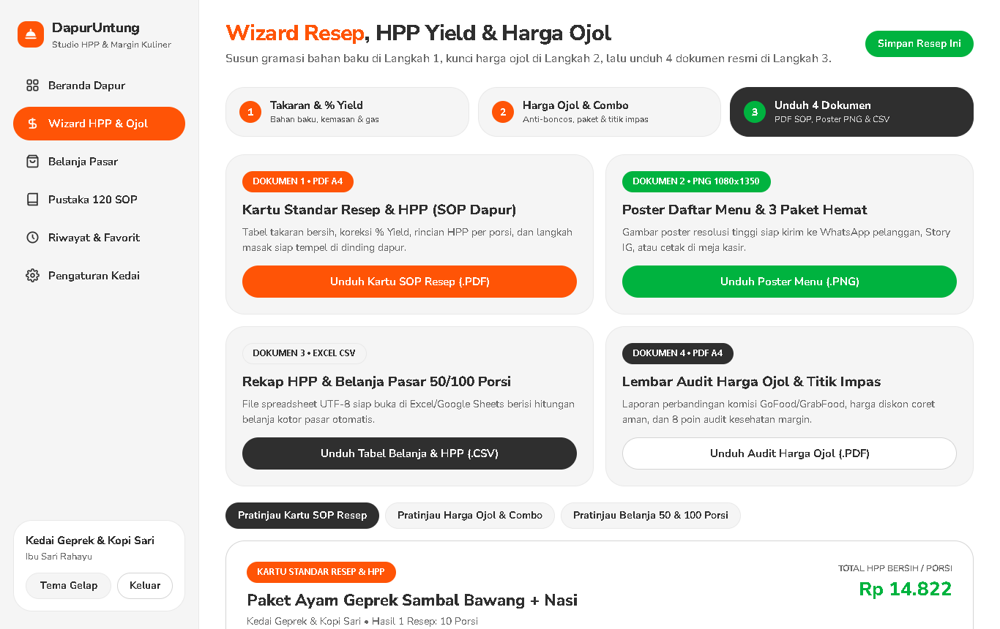
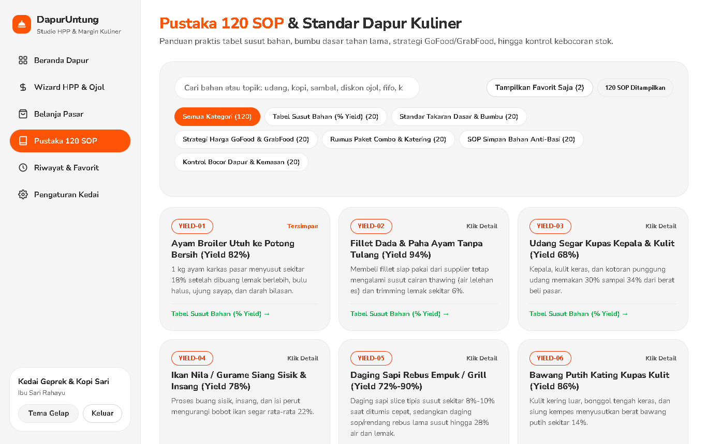
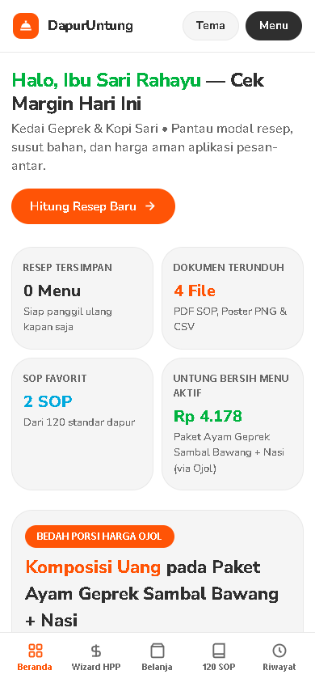

# SETOR PRODUK #9 — DapurUntung Studio

## 1. Identitas Produk
- **Nama Produk:** DapurUntung Studio — Kalkulator HPP Gramasi Resep, Koreksi Susut Bahan (`% Yield`), Harga Anti-Boncos GoFood/GrabFood & Konversi Belanja Pasar Kuliner
- **Siapa Pembelinya:** Pemilik usaha kuliner dan F&B UMKM di Indonesia (kedai kopi/minuman kekinian, warung ayam geprek/penyetan, cloud kitchen rice bowl, booth dimsum/jajanan, home bakery/hampers, warung seblak/mie pedas, serta katering nasi kotak rumahan).
- **Masalah yang Diselesaikan:**
  1. Salah menghitung modal bahan mentah pasar karena lupa memperhitungkan susut kupas kulit, buang tulang/kepala udang, dan penyusutan masak (`% Yield`), sehingga HPP di atas kertas tampak murah padahal modal aslinya membengkak `15%–32%`.
  2. Terjebak menaikkan harga menu GoFood, GrabFood, dan ShopeeFood cuma `+20%` biasa sehingga uang yang cair ke rekening kedai lebih kecil dari harga warung dan tekor saat mengikuti promo diskon coret.
  3. Kebingungan menghitung berapa kilogram kotor bahan yang harus dibeli di pasar pagi (serta berapa nominal wajib DP `50%`) saat menerima pesanan katering `50–250` boks mendadak.
  4. Takaran bumbu serta porsi kru dapur berubah-ubah setiap ganti shift karena belum adanya Kartu Standar Resep (SOP Gramasi) tercetak di meja racik.
- **Harga yang Diusulkan:** **Rp129.000** (sekali bayar untuk selamanya, `100%` mandiri berbasis rumus pasti tanpa ketergantungan AI / tanpa API key / tanpa biaya bulanan).

## 2. Tautan Produksi (Cloudflare Pages)
- **Landing Page (LP):** https://nifari-dapuruntung-lp.pages.dev
- **Web App (Studio):** https://nifari-dapuruntung-app.pages.dev

## 3. Tangkapan Layar Aplikasi (Desktop `1366x860` & Mobile `390x844`)

### Desktop 1 — Beranda Dapur, 4 Cincin Komposisi Harga Ojol & Simulasi Cepat 30 Detik

### Desktop 2 — Wizard Langkah 1 (8 Preset Menu Kuliner, Gramasi Bahan & Koreksi `% Yield`)

### Desktop 3 — Wizard Langkah 3 (Pratinjau Kartu SOP Resep & Mesin Cetak 4 Dokumen)

### Desktop 4 — Pustaka 120 SOP & Rumus Operasional Dapur Kuliner (6 Kategori)

### Mobile HP (`390x844`) — Navigasi Tab Bawah Responsif Tanpa Geser Samping

## 4. Ringkasan Pengujian & Hasil Verifikasi Browser Asli (Google Chrome + Playwright)

| Komponen yang Diuji | Metode & Skenario Uji | Hasil Aktual | Status |
|---|---|---|---|
| **Gerbang Lisensi SHA-256 (`#login-form`)** | Uji penolakan kode salah, uji akses cepat pengembang dengan kolom kosong, uji lisensi pembeli lengkap, dan sesi `localStorage` | Kode salah ditolak rapi; sesi valid terbuka mulus dan tersimpan di browser | LULUS |
| **Sistem Desain Foodnoms (`26px` Flat)** | Audit `getComputedStyle` pada tombol, kartu, input, cincin SVG, dan cek karakter emoji | `borderRadius: 26px`, `boxShadow: none`, `0` gradien, `0` emoji | LULUS |
| **Mesin HPP Gramasi & Koreksi `% Yield`** | Uji 8 preset kuliner Indonesia, tambah/ubah/hapus bahan baku, hitung biaya efektif bersih setelah susut | HPP bahan per batch & per porsi terhitung akurat secara instan | LULUS |
| **Rumus Balik GoFood/GrabFood, Combo & BEP** | Bandingkan kenaikan biasa vs rumus balik komisi `20% + Rp1.000`, diskon coret, 3 paket combo, BEP harian, dan 8 poin audit | Seluruh angka uang cair kedai, 3 paket hemat, dan BEP tampil presisi | LULUS |
| **Ekspor 1 — Kartu SOP Resep (`.PDF` A4)** | Unduh dari Langkah 3 (`SOP-Resep-HPP-paket-ayam-geprek-sambal-bawang-nasi.pdf`) | File `%PDF-1.4` asli (`7.822 bytes`), tabel gramasi & langkah masak rapi | LULUS |
| **Ekspor 2 — Poster Daftar Menu (`.PNG` `1080x1350`)** | Render HTML5 Canvas resolusi tinggi siap WA/IG/kasir | File PNG asli (`96.690 bytes`, header `89504e47`), tajam bergaya Foodnoms | LULUS |
| **Ekspor 3 — Belanja Pasar & HPP (`.CSV` Excel)** | Unduh spreadsheet otomatis untuk 1 batch, 50 porsi, 100 porsi & target katering | File CSV UTF-8 BOM (`1.845 bytes`, header `efbbbf`) siap buka di Excel | LULUS |
| **Ekspor 4 — Audit Harga Ojol (`.PDF` A4)** | Unduh laporan perbandingan komisi aplikasi, combo & titik impas | File `%PDF-1.4` asli (`6.660 bytes`), lengkap 8 poin audit margin | LULUS |
| **Kalkulator Belanja Pasar & Pustaka 120 SOP** | Uji skala 25–250 porsi + buffer `3%` + DP `50%`, filter 6 kategori x 20 SOP, cari kata kunci, dan tutup modal via `Escape` | Tepat `120` SOP tampil tanpa AI; konversi kotor pasar akurat; `Escape` mulus | LULUS |
| **Landing Page Tunggal (`lp/index.html`)** | Verifikasi ukuran total file, 12 bagian wajib, demo hitung live + unduh Poster PNG, dan `#checkoutForm` | Ukuran total `~252 KB` (`< 1 MB`), demo interaktif & unduh sampel PNG berjalan mulus | LULUS |
| **Responsivitas HP (`390x844`) & Console Bersih** | Cek `document.documentElement.scrollWidth` di seluruh halaman App & LP serta pantau console browser | `scrollWidth === 390` di semua tampilan; `0` console error | LULUS |
