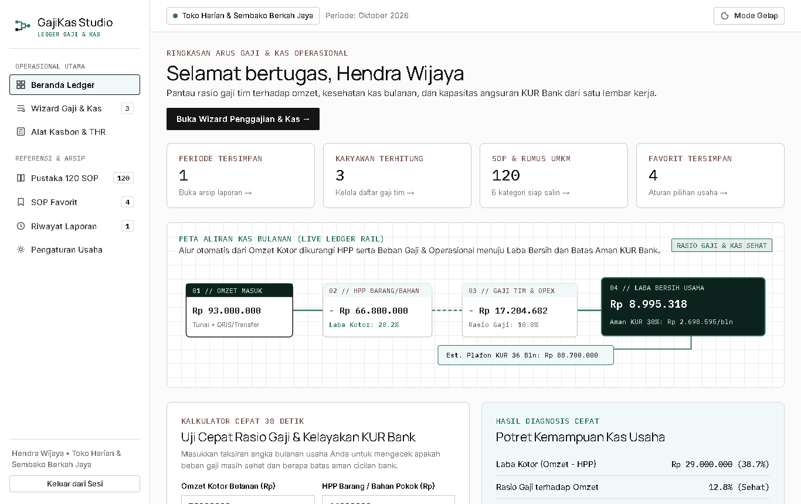
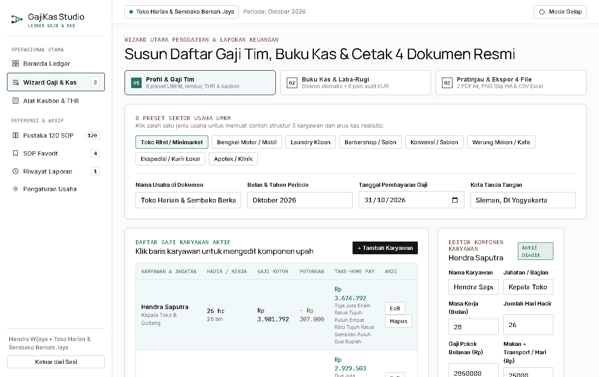
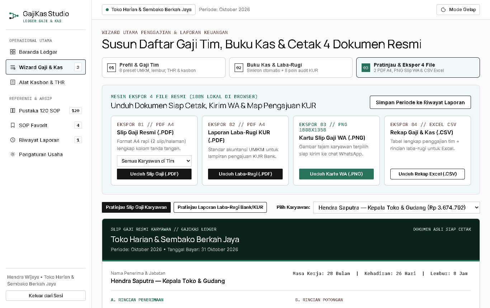
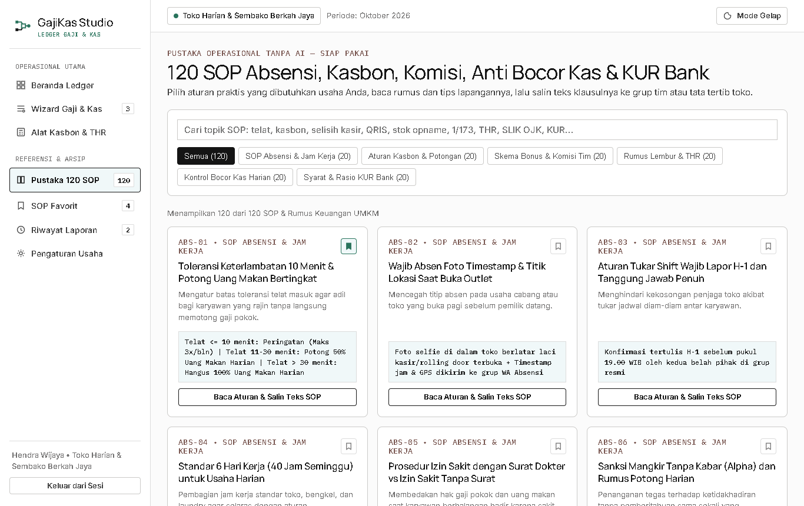
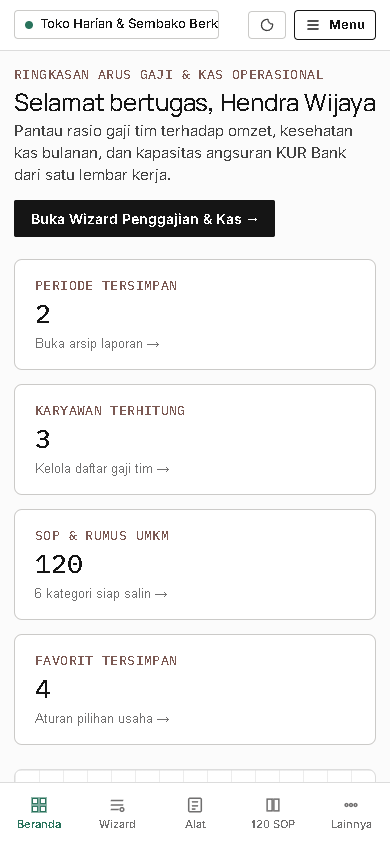

# SETOR PRODUK #8 — GajiKas Studio

## 1. Identitas Produk
- **Nama Produk:** GajiKas Studio — Ruang Kerja Penggajian Karyawan, Slip Gaji WA/PDF & Laporan Laba-Rugi Standar KUR Bank untuk UMKM
- **Siapa Pembelinya:** Pemilik UMKM Indonesia dengan 1–30+ karyawan (toko ritel/minimarket, bengkel motor/mobil, laundry kiloan, barbershop/salon, konveksi/sablon, warung makan/kafe, ekspedisi/kurir lokal, dan apotek/klinik).
- **Masalah yang Diselesaikan:**
  1. Rekap kehadiran, uang makan harian, upah lembur (rumus Depnaker `1/173` maupun tarif tetap), serta sisa cicilan kasbon masih dihitung manual di kertas sehingga rawan selisih dan salah paham dengan staf.
  2. Kebingungan menghitung THR proporsional bagi staf dengan masa kerja di bawah 12 bulan serta penulisan kalimat Terbilang Rupiah pada slip gaji.
  3. Uang laci kasir tercampur pengeluaran operasional tanpa indikator rasio beban gaji terhadap omzet (ideal `< 25–30%`).
  4. Belum tersedianya dokumen Laporan Laba-Rugi formal beserta hitungan kapasitas aman angsuran KUR Bank (`30% x Laba Bersih`) ketika disurvei petugas bank.
- **Harga yang Diusulkan:** **Rp 99.000** (sekali bayar untuk selamanya, `0%` ketergantungan AI / tanpa biaya API / tanpa tagihan bulanan).

## 2. Tautan Produksi (Cloudflare Pages)
- **Landing Page (LP):** https://nifari-gajikas-lp.pages.dev
- **Web App (Studio):** https://nifari-gajikas-app.pages.dev

## 3. Tangkapan Layar Aplikasi (Desktop `1366x860` & Mobile `390x844`)

### Desktop 1 — Beranda Ledger, Diagram Aliran Kas & Kalkulator Cepat 30 Detik

### Desktop 2 — Wizard Langkah 1 (8 Preset UMKM, Tabel Gaji Tim, THR & Terbilang Otomatis)

### Desktop 3 — Wizard Langkah 3 (Pratinjau Dokumen Resmi & Mesin Ekspor 4 File)

### Desktop 4 — Pustaka 120 SOP & Rumus Keuangan UMKM (6 Kategori)

### Mobile HP (`390x844`) — Navigasi Bawah & Tata Letak Responsif Tanpa Geser Samping

## 4. Ringkasan Pengujian & Hasil Verifikasi Browser Asli (Google Chrome + Playwright)

| Komponen yang Diuji | Metode & Skenario Uji | Hasil Aktual | Status |
|---|---|---|---|
| **Gerbang Lisensi SHA-256 (`#login-form`)** | Uji penolakan kode salah, uji masuk kode valid dengan kolom kosong untuk pengembang, serta persistensi sesi `localStorage` saat muat ulang | Kode salah ditolak rapi; sesi valid terbuka mulus dan tersimpan aman | LULUS |
| **Kalkulator Cepat & Sinkronisasi Wizard** | Input omzet, HPP, gaji, dan opex di Beranda lalu klik kirim ke Buku Kas Wizard | Data terkirim akurat ke Langkah 2 dan memperbarui diagram aliran kas | LULUS |
| **Mesin Penggajian, Lembur `1/173`, THR & Terbilang** | Uji 8 preset sektor UMKM, tambah/edit/hapus staf, toggle THR penuh (`>=12 bln`) vs proporsional (`<12 bln`), dan konversi `angkaKeTerbilang` | Seluruh angka Take-Home Pay, THR, dan kalimat Terbilang Rupiah akurat | LULUS |
| **Buku Kas, Laba-Rugi & 8 Poin Audit KUR** | Sinkronisasi beban gaji tim dari Langkah 1 ke Langkah 2 serta uji 8 indikator kesehatan kas & RPC KUR `30%` | 8 indikator audit & estimasi plafon KUR 36 bulan tampil real-time | LULUS |
| **Ekspor 1 — Slip Gaji Resmi (`.PDF` A4)** | Unduh langsung dari Langkah 3 (`Slip-Gaji-Resmi-tim-oktober-2026.pdf`) | File `%PDF-1.4` asli (`9.613 bytes`), 2 slip/halaman A4, nol teks meluber | LULUS |
| **Ekspor 2 — Laporan Laba-Rugi KUR (`.PDF` A4)** | Unduh langsung dari Langkah 3 (`Laporan-Laba-Rugi-KUR-...pdf`) | File `%PDF-1.4` asli (`6.218 bytes`), format standar bank lengkap tanda tangan | LULUS |
| **Ekspor 3 — Kartu Slip Gaji WA (`.PNG` `1080x1350`)** | Render HTML5 Canvas resolusi tinggi siap kirim WhatsApp | File PNG asli (`88.082 bytes`, header `89504e47`), tajam & rapi | LULUS |
| **Ekspor 4 — Rekap Gaji & Kas Excel (`.CSV`)** | Unduh tabel penggajian tim + rincian laba-rugi bulanan | File CSV UTF-8 BOM (`2.474 bytes`, header `efbbbf`) siap buka di Excel | LULUS |
| **Pustaka 120 SOP, Favorit & Modal** | Verifikasi jumlah item per kategori (6 x 20), pencarian kata kunci, simpan favorit, tutup modal via `Escape` & klik latar | Tepat 120 SOP tampil tanpa AI prompt; modal tertutup mulus dengan `Escape` | LULUS |
| **Landing Page Tunggal (`lp/index.html`)** | Verifikasi ukuran total file, 12 bagian wajib, unduh sampel PNG di demo LP, form `#checkoutForm`, dan tipografi Modern Treasury (`71px/450`) | Ukuran total `325.549 bytes` (`317,9 KB` < `1 MB`), demo PNG (`72.235 bytes`) berhasil diunduh | LULUS |
| **Responsivitas HP (`390x844`) & Kebersihan Console** | Cek `document.documentElement.scrollWidth` di seluruh halaman App & LP serta pantau error console/halaman | `scrollWidth === 390` di semua tampilan; `0` console error; `0` emoji | LULUS |
