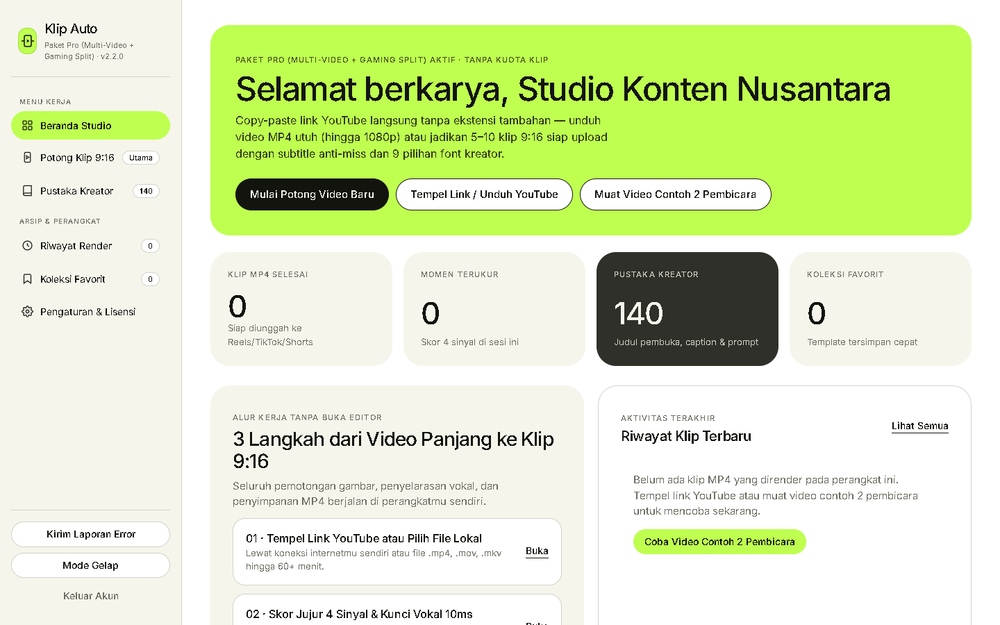
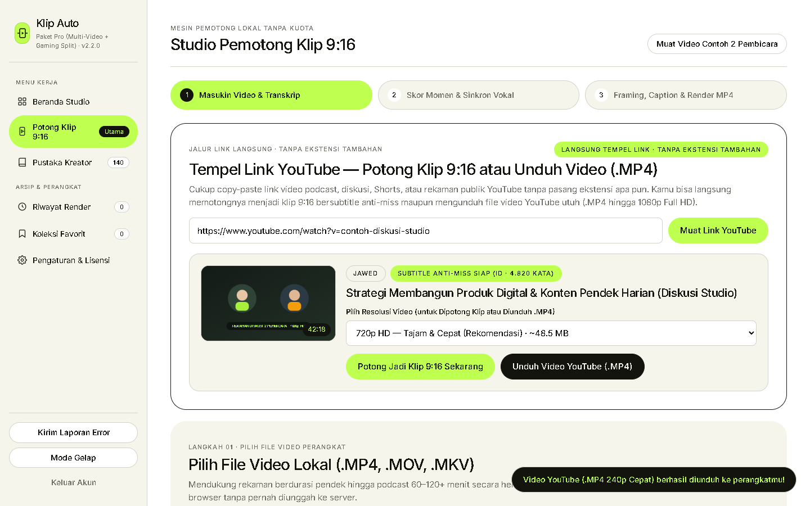
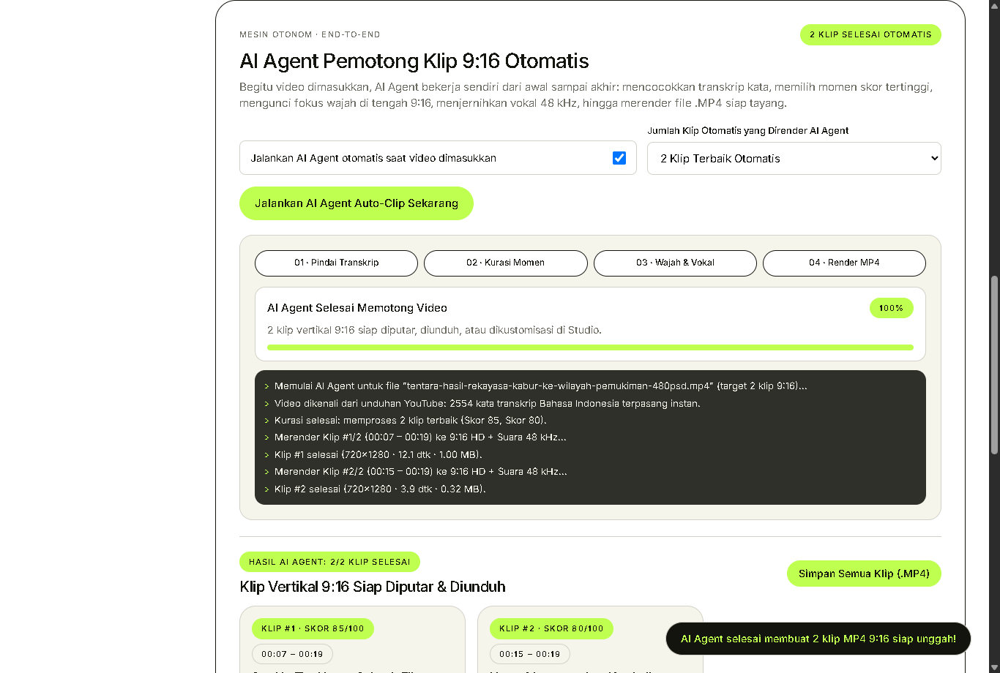
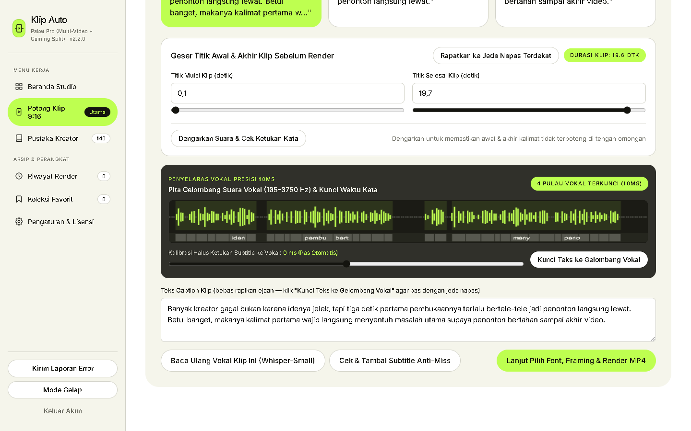
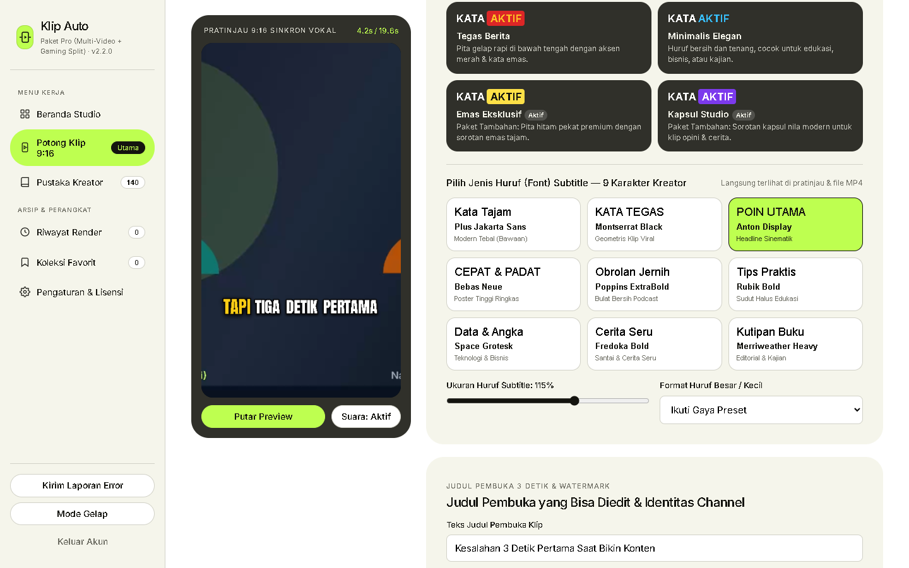
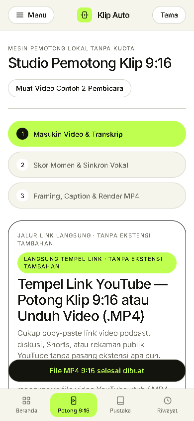

# SETOR PRODUK #3 — Klip Auto Studio v2.2

## 1. Profil Produk & Skema Paket Harga
- **Nama Produk:** Klip Auto Studio — Copy-Paste Link YouTube Tanpa Ekstensi, Unduh Video `.MP4`, Subtitle Anti-Miss & 9 Pilihan Font (`v2.2.0`)
- **Siapa Pembelinya:** Kreator konten TikTok/Reels/Shorts, podcaster, tim dokumentasi webinar/kajian, pemilik UMKM, serta penyedia jasa *clipping* video pendek di Indonesia yang memakai laptop Windows maupun macOS (termasuk laptop kantor RAM 8 GB).
- **Masalah Utama yang Diselesaikan:**
  1. Memotong rekaman podcast atau diskusi berdurasi **60–120+ menit** menjadi klip vertikal 9:16 biasanya menyita waktu berjam-jam untuk mengunduh video sumber, mencari menit pembicaraan yang kuat, mengatur posisi 1 atau 2 wajah agar tidak terpotong di tengah, dan menambal timing subtitle yang meleset atau hilang di tengah kalimat.
  2. Alat lama mewajibkan instalasi terminal rumit (`FFmpeg` / `yt-dlp`), memasang ekstensi tambahan, atau bergantung pada konverter iklan yang tidak aman, sementara layanan *cloud* luar memungut biaya langganan bulanan berulang dan membatasi kuota menit.
  3. **Klip Auto Studio v2.2** berjalan langsung di browser perangkat pembeli **tanpa perlu ekstensi tambahan**: cukup **copy-paste link YouTube** untuk langsung memotong jadi klip `9:16` maupun **mengunduh video YouTube utuh (`.MP4` 360p s/d 1080p Full HD)** ke perangkat, dilengkapi **Mesin Subtitle Anti-Miss (`Zero-Miss` `10ms` + Penambal Celah Bicara `Xenova/whisper-small`)** agar tidak ada kata pembicara yang terlewat atau berkedip hilang di tengah kalimat, **Pemilih 9 Jenis Font Subtitle Kreator** (lengkap pengatur ukuran `80%–135%` & format huruf), deteksi otomatis 1 atau 2 wajah (**Fullscreen Tengah** & **Podcast Split atas-bawah** tanpa keyframe manual), serta ekspor MP4 bersih tanpa watermark dengan akselerasi GPU dan cadangan CPU otomatis.
- **Skema Harga Sekali Bayar (Tanpa Kuota & Tanpa Langganan):**
  - **Paket Inti — Rp99.000 (Sekali Bayar):** Copy-paste link YouTube langsung tanpa ekstensi tambahan + unduh video YouTube `.MP4` (`360p`–`1080p Full HD`), impor file lokal hingga 60–120+ menit, pemotong batch 5–10 klip otomatis berisolasi error, skor jujur 4 sinyal, **Subtitle Anti-Miss `10ms`** + `Whisper-Small` (ID & EN), deteksi otomatis 1/2 wajah (Fullscreen, Podcast Split, Cinema Blur), **9 pilihan font subtitle kreator** + 6 gaya warna caption populer, judul pembuka 3 detik yang bisa diedit, ekspor MP4 720p/1080p **tanpa watermark**, 140 pustaka referensi kreator, sewa offline 7 hari, dan pindah perangkat mandiri (1 laptop aktif).
  - **Paket Tambahan (Order Bump di Halaman Checkout) — +Rp49.000 (Total Rp148.000):** Membuka fitur pasang logo PNG / teks watermark channel sendiri + 2 gaya caption ekstra (*Sorot Elektrik* & *Fokus Kata*).
  - **Paket Pro (Kesiapan Ekspansi Agensi/Editor):** Mendukung antrean *Batch Multi-Video* sekaligus, mode framing *Gaming Split* (facecam atas + layar permainan bawah), dan aktivasi beberapa perangkat.

---

## 2. Link Live (Cloudflare Pages)
- **Link Landing Page (LP Jualan):** [https://nifari-klip-auto-lp.pages.dev](https://nifari-klip-auto-lp.pages.dev)
- **Link Web App (Aplikasi Pembeli):** [https://nifari-klip-auto-app.pages.dev](https://nifari-klip-auto-app.pages.dev)
  - *Keamanan Lisensi & Aset Server:* Kode lisensi, hash, maupun salt **tidak disimpan di kode sumber aplikasi atau repositori**, melainkan divalidasi di server melalui konfigurasi rahasia terenkripsi (`KLIP_AUTO_LICENSE_CONFIG`). File mesin aplikasi inti (`/wizard-controller.js`, `/engine/*`, `/vendor/*`, `/data/*`) maupun jalur YouTube (`/api/youtube/*`) dikunci oleh server (`401 AUTH_REQUIRED`) hingga lisensi dinyatakan sah, mengikat 1 perangkat aktif dengan fitur **Pindah Perangkat Mandiri**, serta menyediakan masa sewa kerja offline terenkripsi selama 7 hari.

---

## 3. Tangkapan Layar Aplikasi (Desktop + HP — Bebas Wajah Tokoh Publik)

### Desktop 1 — Beranda Studio, Status Paket, & Pintasan "Tempel Link Tanpa Ekstensi"

### Desktop 2 — Copy-Paste Link YouTube Tanpa Ekstensi + Tombol Unduh Video YouTube (`.MP4`)

### Desktop 3 — Pemotong Batch Klip 9:16 Otomatis dengan Isolasi Error Per Klip

### Desktop 4 — Subtitle Anti-Miss Presisi 10ms (`165–3750 Hz`) & Tombol Cek + Tambal Celah Bicara

### Desktop 5 — Pemilih 9 Jenis Font Subtitle Kreator, Ukuran Font, & Podcast Split 2 Wajah

### Tampilan HP (`390×844`) — Navigasi Bawah Rapi & Presisi `scrollWidth = 390px`

---

## 4. Ringkasan Pengujian Nyata & Bukti
Seluruh pengujian dijalankan di **Google Chrome 156** (tanpa ekstensi browser tambahan pada v2.2) dan didokumentasikan secara jujur beserta file bukti asli di [`HASIL-TES.md`](./HASIL-TES.md) dan folder [`./bukti-tes/`](./bukti-tes/):
- **Copy-Paste Link YouTube Tanpa Ekstensi & Unduh Video `.MP4` Langsung di Live Cloudflare Pages (`v2.2.0`):** Berhasil memuat podcast Indonesia `78,5 menit` (`7.880 kata` subtitle `srv3`) serta mengunduh file video `.MP4` utuh langsung dari tombol **Unduh Video YouTube (`.MP4`)**, lalu memotongnya di Studio dalam `~130 md` lewat *cache* memori tanpa mengunduh ulang (`0` error konsol).
- **Subtitle Anti-Miss (`Zero-Miss`) & 9 Pilihan Font Subtitle Kreator (`v2.2.0`):** Jembatan jeda mikro `< 0,42 dtk` + pemindai celah vokal `ensureZeroMissClipSubtitles` memastikan tidak ada kalimat yang bolong atau berkedip hilang, dan ekspor MP4 terverifikasi visual pada berbagai karakter font kustom (**Anton Display** tinggi padat hingga **Fredoka Bold** bulat ramah).
- **Rekaman Lokal 22 Menit Tanpa Subtitle (Bahasa Indonesia + Istilah Inggris) & Ketahanan Error/Lisensi:** Ditranskripsi oleh **`Xenova/whisper-small` (`WebGPU`)**, dikunci ke gelombang suara vokal `10ms`, serta lulus seluruh uji gagal link, internet putus, disk hampir penuh (`< 65 MB`), pindah laptop mandiri, dan sewa offline 7 hari.
