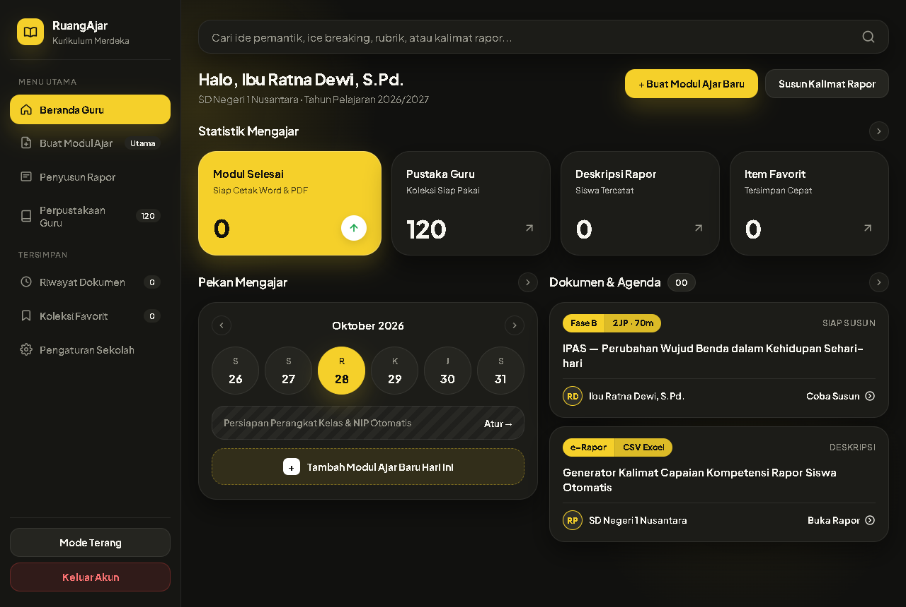
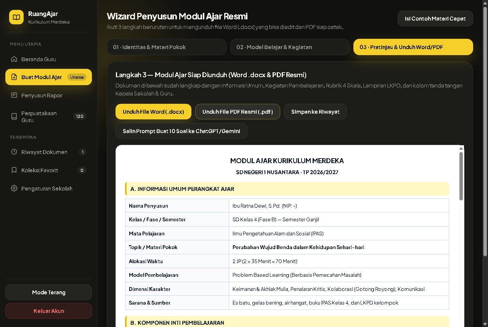
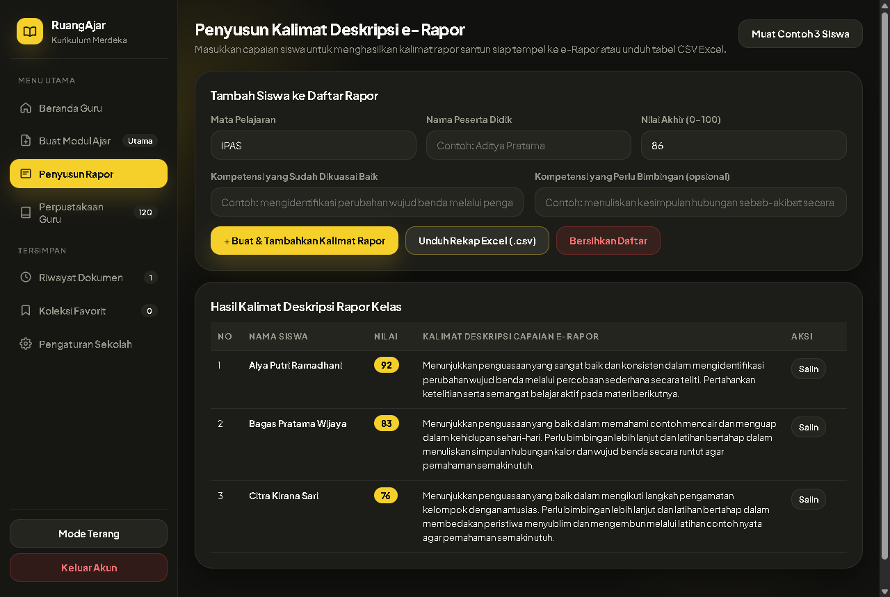
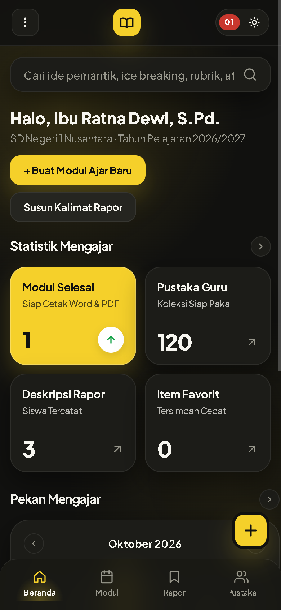

# SETOR PRODUK #1 — RuangAjar Merdeka

## 1. Profil Produk & Usulan Harga
- **Nama Produk:** RuangAjar Merdeka — Studio Penyusun Modul Ajar Kurikulum Merdeka & Kalimat Deskripsi e-Rapor Guru
- **Siapa Pembelinya:** Guru kelas SD/MI (Fase A–C), guru mata pelajaran SMP/MTs (Fase D), guru SMA/MA/SMK (Fase E–F), wali kelas, serta guru honorer/P3K/PNS di seluruh Indonesia.
- **Masalah Apa yang Diselesaikan:**
  1. Guru kehabisan waktu istirahat di malam hari untuk merapikan tabel Modul Ajar, menghitung pembagian menit Jam Pelajaran (JP), dan mengganti identitas sekolah/NIP secara berulang menjelang supervisi kepala sekolah.
  2. Kesulitan merangkai urutan sintaks Kegiatan Inti sesuai model pembelajaran (*Problem Based Learning*, *Project Based Learning*, *Discovery Learning*, *Berdiferensiasi*), menyusun tabel Rubrik Penilaian 4 Skala, serta menyiapkan lembar LKPD dari nol.
  3. Kelelahan merangkai puluhan kalimat deskripsi capaian kompetensi dan saran bimbingan yang santun satu per satu saat pengisian e-Rapor akhir semester.
- **Harga Jual yang Diusulkan:** **Rp129.000** (sekali bayar untuk akses penuh aplikasi web selamanya, tanpa biaya langganan bulanan & berjalan mandiri 100% tanpa perlu kunci API berbayar).

---

## 2. Link Live (Cloudflare Pages)
- **Link Landing Page (LP Jualan):** [https://nifari-modul-ajar-lp.pages.dev](https://nifari-modul-ajar-lp.pages.dev)
- **Link Web App (Aplikasi Pembeli):** [https://nifari-modul-ajar-app.pages.dev](https://nifari-modul-ajar-app.pages.dev)
  - *Cara masuk cepat untuk penguji:* Klik tombol **Isi Cepat Contoh Akun Pembeli** di halaman masuk (atau masukkan kode akses `GURU-MERDEKA-2026`), lalu klik **Masuk ke Ruang Kerja**.

---

## 3. Tangkapan Layar Aplikasi (3 Desktop + 1 HP)

### Desktop 1 — Beranda Guru (Bento Statistik, Kalender Kapsul Mingguan & Agenda Dokumen)

### Desktop 2 — Wizard Modul Ajar Langkah 3 (Pratinjau Resmi, Unduh Word .docx & PDF A4)

### Desktop 3 — Penyusun Kalimat Deskripsi e-Rapor Siswa & Ekspor Rekap Excel (.csv)

### Tampilan HP (Lebar 390px) — Navigasi Bawah 4 Menu & Tombol Aksi Cepat Tanpa Geser Samping

*(Tangkapan layar tambahan juga tersimpan di folder `./screenshots/`: `04-perpustakaan-guru-desktop.png` untuk Perpustakaan 120 Koleksi Guru, serta `05-mode-terang-desktop.png` untuk tampilan Mode Terang Hangat).*

---

## 4. Apa yang Sudah Dites & Hasilnya

Seluruh pengujian dijalankan menggunakan browser **Google Chrome asli** pada ukuran layar Desktop (`1366×860` / `1280×860`) dan HP (`390×844`):

| Bagian yang Dites | Skenario Pengujian | Hasil |
| :--- | :--- | :--- |
| **Login Lisensi Guru** | Masuk menggunakan nama, email, & kode akses (`GURU-MERDEKA-2026`) serta tombol contoh akun pembeli | **Lulus** — Sesi tersimpan di browser, Beranda langsung menyapa nama guru dan satuan pendidikan. |
| **Beranda, Kalender & Statistik** | Cek kartu angka Bento, navigasi minggu pada Kalender Kapsul, klik cepat ke Wizard & Pengaturan | **Lulus** — Seluruh angka riwayat, siswa rapor, koleksi pustaka (`120`), dan favorit terbarui otomatis. |
| **Wizard Modul Ajar 3 Langkah** | Langkah 1 (Identitas & Kelas/Fase) → Langkah 2 (Pilih Model Belajar & Susun Otomatis) → Langkah 3 (Pratinjau) | **Lulus** — Perhitungan menit JP otomatis akurat (`35/40/45` menit), komponen inti, rubrik 4 skala, dan LKPD tersusun lengkap. |
| **Ekspor File Word (`.docx`)** | Klik unduh dokumen Word Modul Ajar | **Lulus** — Menghasilkan file OOXML `.docx` asli lengkap tabel Informasi Umum, Sintaks Kegiatan, Rubrik, LKPD, dan blok tanda tangan Kepala Sekolah + NIP. |
| **Ekspor File PDF Resmi (`.pdf`)** | Klik unduh dokumen PDF A4 siap cetak | **Lulus** — Menghasilkan file PDF A4 multi-halaman asli (header `%PDF-`) lengkap penomoran halaman otomatis di bagian bawah. |
| **Hand-off Prompt Soal AI** | Klik tombol salin prompt 10 soal & kunci jawaban ke ChatGPT/Gemini | **Lulus** — Prompt lengkap sesuai topik, mata pelajaran, dan jenjang kelas tersalin rapi ke papan klip tanpa biaya server. |
| **Penyusun Deskripsi e-Rapor (`.csv`)** | Tambah data capaian siswa, salin kalimat individu, dan unduh rekap satu kelas `.csv` ber-BOM UTF-8 | **Lulus** — Kalimat rapor menyesuaikan rentang nilai secara santun dan file `.csv` langsung terbaca rapi di Microsoft Excel. |
| **Perpustakaan 120 Koleksi Guru** | Filter 6 kategori & jenjang kelas, cari kata kunci, buka modal detail + tips, simpan favorit, dan kirim ke Wizard | **Lulus** — Seluruh **120 item** tampil utuh dan langsung mengisi kolom yang sesuai di Wizard Modul Ajar. |
| **Pengaturan NIP, Riwayat & Tema** | Simpan profil sekolah + NIP, cek pencegahan duplikat riwayat, ganti Mode Gelap ↔ Mode Terang | **Lulus** — Identitas sekolah otomatis mengisi dokumen baru; kontras warna Obsidian Matte & Warm Cream bersih. |
| **Landing Page (`< 1 MB`)** | Cek ukuran file tunggal (`481,4 KB`), 12 bagian lengkap, animasi Hero, serta 2 tab Demo Interaktif (Modul & Rapor) | **Lulus** — Ukuran di bawah batas 1 MB, 5 gambar WebP termuat penuh, kedua tab demo merespons *real-time* saat input diubah. |
| **Responsif HP (`390px`) & Console** | Cek `scrollWidth` di semua menu App & LP pada lebar layar `390px` serta periksa log console browser | **Lulus** — `scrollWidth = 390px` (bebas meluber ke samping) dan **0 error** di console baik di App maupun LP. |
