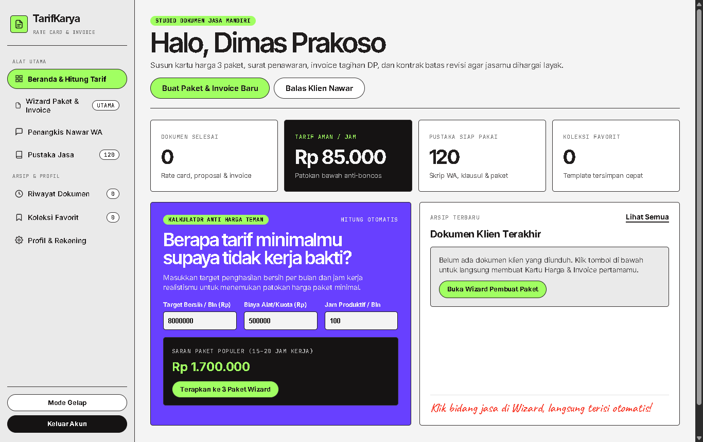
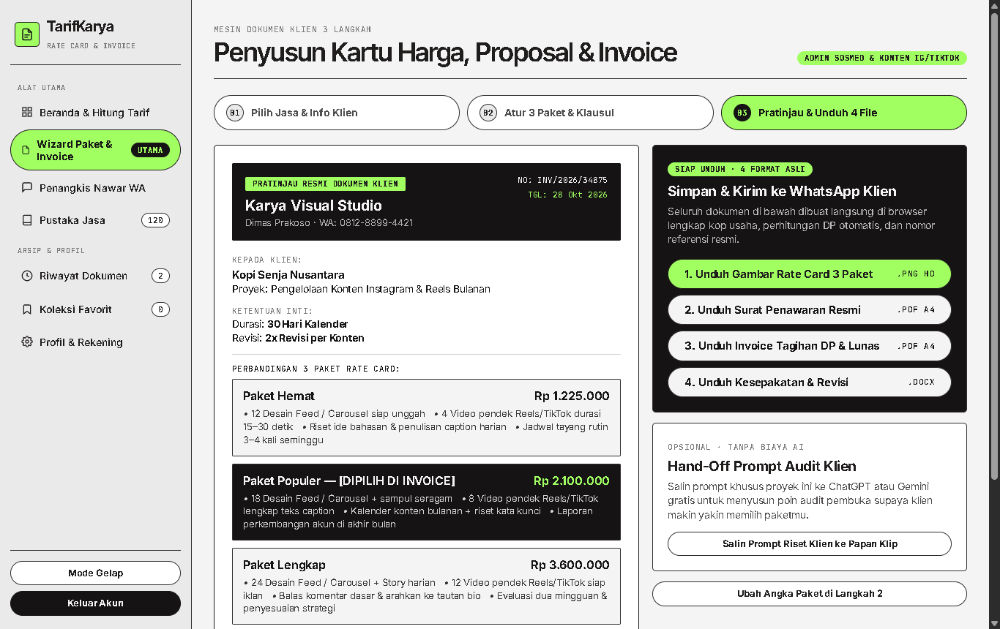
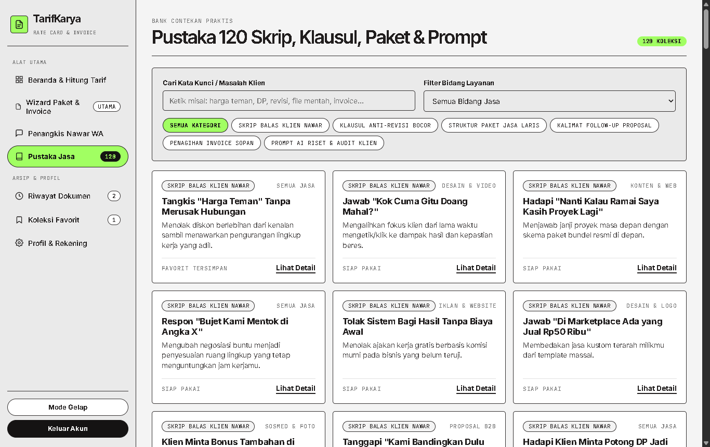
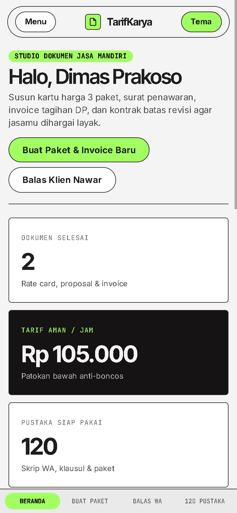

# SETOR PRODUK #4 — TarifKarya Studio

## 1. Profil Produk & Usulan Harga
- **Nama Produk:** TarifKarya Studio — Studio Proposal, Kartu Harga (Rate Card) 3 Paket & Invoice Jasa
- **Siapa Pembelinya:** Pekerja lepas (*freelancer*), penyedia jasa kreatif & digital (admin sosmed, editor video pendek Reels/TikTok, desainer grafis, pembuat website/landing page, fotografer produk, penulis konten, pengelola iklan, hingga asisten virtual), serta studio/agensi kecil di Indonesia.
- **Masalah Apa yang Diselesaikan:**
  1. Penyedia jasa sering diminta **"harga teman"** atau ditawar sadis karena hanya mengirim nominal harga berupa teks chat polosan tanpa pilihan paket dan rincian resmi.
  2. Lingkup kerja sering melebar (*revisi beranak pinak*), klien tiba-tiba meminta file mentah gratis, atau pembayaran uang muka (DP) molor karena tidak ada surat kesepakatan kerja tertulis sejak hari pertama.
  3. Banyak pekerja lepas sudah terlanjur keluar uang Rp500.000–Rp1.200.000 membeli kursus online yang isinya hanya video teori panjang, tetapi tetap bingung menyusun dokumen penawaran, kartu harga, dan tagihan resmi saat ada prospek klien masuk.
- **Harga Jual yang Diusulkan:** **Rp129.000** (sekali bayar untuk akses penuh aplikasi web seumur hidup, tanpa biaya langganan bulanan & berjalan 100% mandiri di browser tanpa kuota API berbayar).

---

## 2. Link Live (Cloudflare Pages)
- **Link Landing Page (LP Jualan):** [https://nifari-paket-freelancer-lp.pages.dev](https://nifari-paket-freelancer-lp.pages.dev)
- **Link Web App (Aplikasi Pembeli):** [https://nifari-paket-freelancer-app.pages.dev](https://nifari-paket-freelancer-app.pages.dev)
  - *Cara masuk cepat untuk penguji:* Klik tombol **Isi Cepat Akun Contoh Pembeli** di halaman masuk (atau masukkan kode lisensi `FREELANCE-2026-PRO`), lalu klik **Masuk ke TarifKarya Studio**.

---

## 3. Tangkapan Layar Aplikasi (3 Desktop + 1 HP)

### Desktop 1 — Beranda Studio & Kalkulator Anti Harga Teman

### Desktop 2 — Wizard Langkah 3: Pratinjau Resmi & Ekspor 4 Dokumen Klien (.PNG, 2x .PDF, .DOCX)

### Desktop 3 — Pustaka 120 Skrip Balas Klien Nawar, Klausul Revisi, Paket & Prompt Riset

### Tampilan HP (Lebar 390px) — Floating Pill Bar, Kartu Tajam & Navigasi Bawah Tanpa Geser Samping

*(Tangkapan layar tambahan juga tersimpan di folder `./screenshots/`: `01-login-desktop.png` untuk Layar Akses Lisensi Pembeli dan `04-penangkis-wa-desktop.png` untuk Generator Balasan WhatsApp Penangkis Nawar).*

---

## 4. Apa yang Sudah Dites & Hasilnya

Seluruh pengujian dijalankan menggunakan browser **Google Chrome asli** pada ukuran layar Desktop (`1366×860`) dan HP (`390×844`):

| Bagian yang Dites | Skenario Pengujian | Hasil |
| :--- | :--- | :--- |
| **Login Lisensi Pembeli** | Masuk memakai nama studio, email, & kode lisensi (`FREELANCE-2026-PRO`) serta tombol akun contoh | **Lulus** — Sesi tersimpan rapi di browser, langsung menyapa nama pengguna di Beranda. |
| **Kalkulator Anti Harga Teman** | Ubah target bersih bulanan (`Rp10.000.000`), biaya alat/kuota, dan jam kerja produktif lalu terapkan ke Wizard | **Lulus** — Tarif aman per jam (`Rp105.000/jam`) & harga 3 paket di Wizard langsung terhitung dan diperbarui otomatis. |
| **Wizard 3 Langkah** | Pilih 1 dari 8 preset jasa → sesuaikan 3 paket harga, persentase DP, & klausul → buka pratinjau resmi | **Lulus** — Kertas pratinjau menampilkan kop studio, nama klien, perbandingan 3 paket, dan rincian termin DP secara *real-time*. |
| **Ekspor Rate Card (`.png`)** | Klik unduh Gambar Rate Card 3 Paket | **Lulus** — Menghasilkan gambar potret tajam `1080×1350 px` (`85,1 KB`) siap kirim ke WhatsApp klien. |
| **Ekspor Proposal & Invoice (`.pdf`)** | Klik unduh Surat Penawaran Resmi & Invoice Tagihan DP/Pelunasan | **Lulus** — Menghasilkan 2 file PDF A4 asli (`5,0 KB` & `3,4 KB`, header `%PDF-1.4`) lengkap nomor referensi, nominal DP, dan tujuan rekening. |
| **Ekspor Kontrak Revisi (`.docx`)** | Klik unduh Surat Kesepakatan & Revisi | **Lulus** — Menghasilkan file OOXML Word `.docx` asli (`7,7 KB`, header `PK`) berisi pasal lingkup kerja, batas revisi, & aturan watermark. |
| **Penangkis Nawar WhatsApp** | Pilih 6 situasi negosiasi klien (harga teman, minta sampel gratis, tunda DP, minta file mentah, dll.) | **Lulus** — Nama studio, nama klien, harga paket terpilih, dan persentase DP otomatis menyatu ke draf chat sopan siap salin. |
| **Pustaka 120 Koleksi** | Filter 6 kategori, filter bidang jasa, pencarian kata kunci, buka modal detail, simpan favorit, & pasang klausul | **Lulus** — Seluruh **120 item** tampil utuh lengkap penjelasan situasi, contoh kalimat siap pakai, dan tips lapangan. |
| **Sistem Desain (`DESIGN 4.md`)** | Audit warna Concrete `#f4f4f4`, Volt `#a1ff62`, Obsidian `#151313`, Ultraviolet `#6840ff`, sudut tajam `5px` vs pil `1600px`, tanpa *box-shadow* & tanpa emoji | **Lulus** — 100% sesuai spesifikasi *Osmo Design Reference* baik di Web App maupun Landing Page. |
| **Landing Page (`< 1 MB`)** | Cek ukuran file tunggal (`529,7 KB`), 12 bagian berurutan, animasi kartu Hero, & Demo Interaktif unduh `.PNG` | **Lulus** — Ukuran jauh di bawah batas 1 MB, seluruh 5 gambar WebP termuat penuh, kalkulator demo, checkout, & FAQ berfungsi mulus. |
| **Responsif HP (`390px`) & Console** | Cek `document.documentElement.scrollWidth` di semua layar App & LP serta pantau error console/runtime | **Lulus** — `scrollWidth = 390px` tepat di semua tampilan dan **0 error** di console baik pada Web App maupun Landing Page. |
