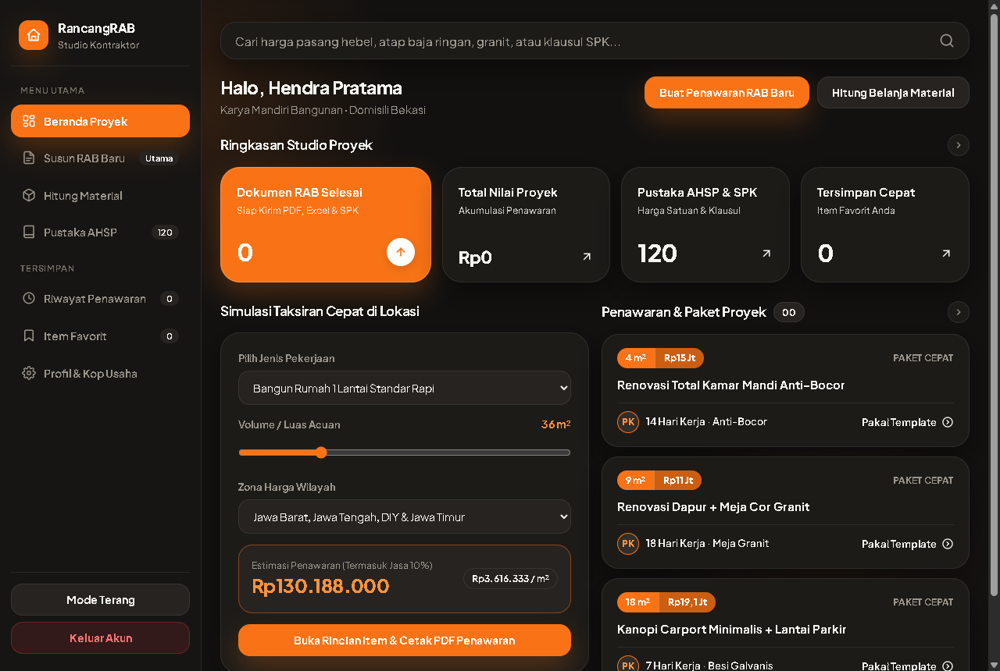
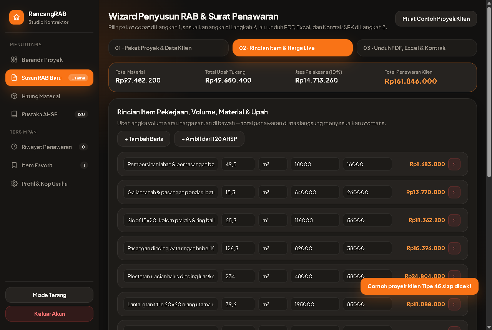
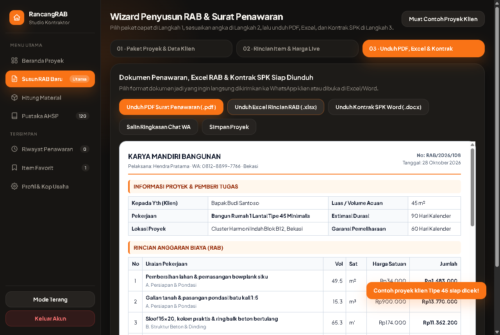
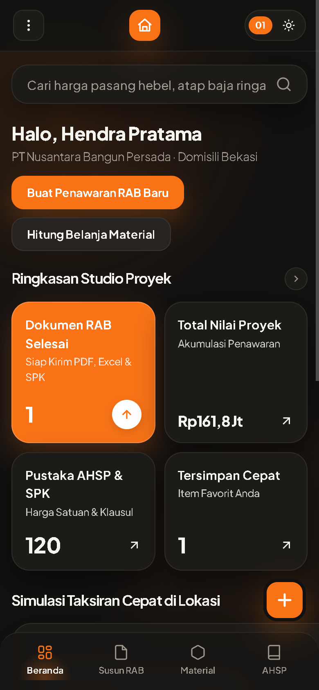

# SETOR PRODUK #2 — RancangRAB Studio

## 1. Profil Produk & Usulan Harga
- **Nama Produk:** RancangRAB Studio — Kalkulator RAB Proyek, Estimasi Material & Generator Surat Penawaran Kontraktor
- **Siapa Pembelinya:** Kontraktor kecil-menengah, pemborong bangunan mandiri, mandor proyek renovasi rumah, tukang las/kanopi baja ringan, dan konsultan/arsitek lepas di seluruh Indonesia.
- **Masalah Apa yang Diselesaikan:**
  1. Pemborong sering telat mengirim penawaran harga habis survei lokasi karena harus merapikan rumus Excel berjam-jam di malam hari, sehingga proyek keburu diambil kompetitor.
  2. Mengirim angka borongan gelondongan lewat chat WhatsApp tanpa rincian item & jadwal termin resmi membuat pemilik rumah ragu dan menawar terlalu rendah.
  3. Keuntungan proyek sering tergerus (boncos) akibat lupa menghitung item kecil, salah menaksir belanja material fisik ke toko bangunan, atau tidak memakai Surat Perjanjian Kerja Borongan (SPK) tertulis untuk mengawal pekerjaan tambah-kurang (*addendum*).
- **Harga Jual yang Diusulkan:** **Rp 99.000** (sekali bayar untuk akses penuh aplikasi web, tanpa biaya langganan bulanan & berjalan 100% mandiri tanpa perlu API key berbayar).

---

## 2. Link Live (Cloudflare Pages)
- **Link Landing Page (LP Jualan):** [https://nifari-rab-kontraktor-lp.pages.dev](https://nifari-rab-kontraktor-lp.pages.dev)
- **Link Web App (Aplikasi Pembeli):** [https://nifari-rab-kontraktor-app.pages.dev](https://nifari-rab-kontraktor-app.pages.dev)
  - *Gerbang Akses Pembeli:* Dilindungi verifikasi hash kriptografi SHA-256 + salt untuk Kode Lisensi Pembeli resmi (tanpa membocorkan kode asli di source code maupun placeholder).

---

## 3. Tangkapan Layar Aplikasi (3 Desktop + 1 HP)

### Desktop 1 — Beranda Studio & Simulasi Taksiran Cepat di Lokasi Survei

### Desktop 2 — Wizard RAB Real-Time (Pisah Modal Material, Upah Tukang & Jasa Pelaksana)

### Desktop 3 — Pratinjau Surat Penawaran Resmi & Ekspor 3 Dokumen (.PDF, .XLSX, .DOCX)

### Tampilan HP (Lebar 390px) — Navigasi Bawah & Kartu Responsif Tanpa Geser Samping

*(Tangkapan layar tambahan juga tersimpan di folder `./screenshots/`: `02-pustaka-ahsp-desktop.png` untuk Pustaka 120 AHSP & Klausul SPK, serta `05-kalkulator-material-desktop.png` untuk Kalkulator Belanja Material Toko Bangunan).*

---

## 4. Apa yang Sudah Dites & Hasilnya

Seluruh pengujian dijalankan menggunakan browser **Google Chrome asli** pada ukuran layar Desktop (`1366×860` / `1280×860`) dan HP (`390×844`):

| Bagian yang Dites | Skenario Pengujian | Hasil |
| :--- | :--- | :--- |
| **Login Lisensi Pembeli** | Masuk menggunakan nama, email, & Kode Lisensi Pembeli tervalidasi SHA-256 (menolak kode sembarang) | **Lulus** — Sesi tersimpan rapi di browser, langsung menyapa nama usaha & pelaksana asli di Beranda. |
| **Simulasi Cepat Beranda** | Pilih jenis proyek, zona harga wilayah Indonesia, dan ubah luas acuan m² | **Lulus** — Angka taksiran wajar, kisaran m², dan tombol lanjut ke Wizard langsung merespons instan. |
| **Wizard RAB 3 Langkah** | Langkah 1 (Data Klien & Template) → Langkah 2 (Edit volume/material/upah real-time) → Langkah 3 (Pratinjau & Unduh) | **Lulus** — Banner total biaya, modal material, upah tukang, fee jasa, dan 4 termin berubah otomatis saat angka diketik. |
| **Ekspor File PDF (`.pdf`)** | Klik unduh Surat Penawaran & RAB Resmi | **Lulus** — Menghasilkan file PDF A4 asli (`23,5 KB`, header `%PDF-`) lengkap kop usaha, tabel rincian, termin pembayaran, dan blok tanda tangan. |
| **Ekspor File Excel (`.xlsx`)** | Klik unduh Spreadsheet RAB Ber-Rumus | **Lulus** — Menghasilkan file OOXML `.xlsx` asli (`4,2 KB`) dengan rumus aktif `F+G`, `ROUND(D*H,0)`, dan `SUM(...)` yang bisa diedit di Excel/Sheets. |
| **Ekspor Kontrak SPK (`.docx`)** | Klik unduh Draf Surat Perjanjian Kerja Borongan | **Lulus** — Menghasilkan file Word `.docx` asli (`2,4 KB`) berisi Pasal 1–5 (Lingkup Kerja, Nilai & Termin, Addendum, Garansi Pemeliharaan, Tanda Tangan). |
| **Pustaka 120 AHSP & SPK** | Filter 6 kategori, pencarian kata kunci, klik detail modal, simpan favorit, dan masukkan item ke Wizard | **Lulus** — Seluruh **120 item** tampil lengkap beserta rincian harga material/upah, koefisien lapangan, dan tips anti-rugi. |
| **Kalkulator Belanja Material** | Hitung fisik buah hebel/bata, sak semen, pasir, split, dus granit, dan galon cat + salin daftar WA toko bangunan | **Lulus** — Angka pembulatan fisik & ringkasan teks siap kirim keluar akurat. |
| **Riwayat, Kop Usaha & Tema** | Simpan profil usaha, cek tidak ada duplikat riwayat saat unduh beruntun, ganti Mode Gelap ↔ Mode Terang | **Lulus** — Riwayat tercatat rapi (`badge: 1`), identitas kop langsung memperbarui pratinjau surat, kontras gelap & terang bersih. |
| **Landing Page (`< 1 MB`)** | Cek ukuran file tunggal (`459,9 KB`), 12 bagian lengkap, animasi Hero, dan klik Demo Kalkulator Interaktif | **Lulus** — Ukuran jauh di bawah batas 1 MB, seluruh 5 gambar WebP termuat penuh, total demo berubah *real-time* saat paket/luas/volume diubah. |
| **Responsif HP (`390px`) & Console** | Cek lebar dokumen (`scrollWidth`) di semua halaman App & LP serta log console browser | **Lulus** — `scrollWidth = 390px` (tidak ada elemen meluber ke samping) dan **0 error** di console baik di App maupun LP. |
