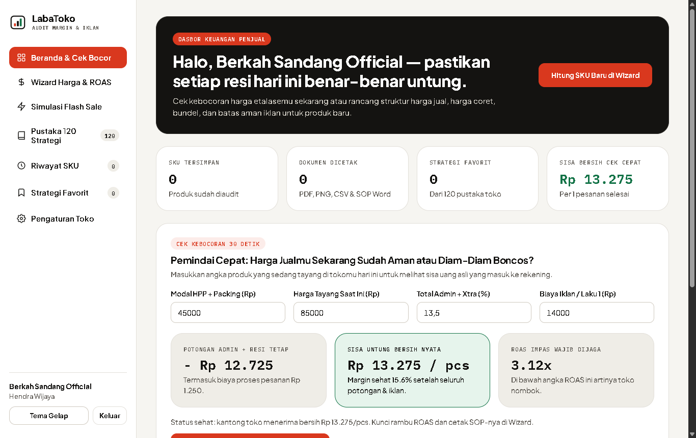
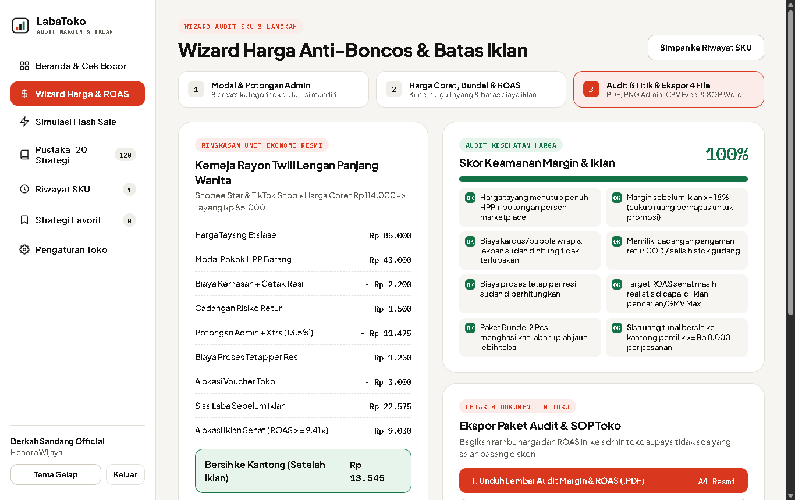
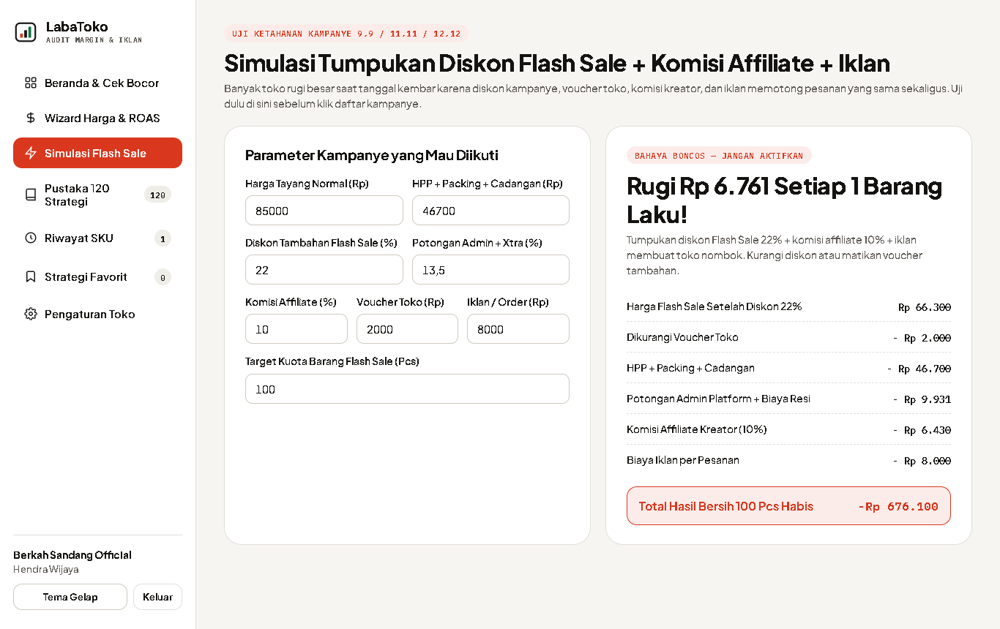
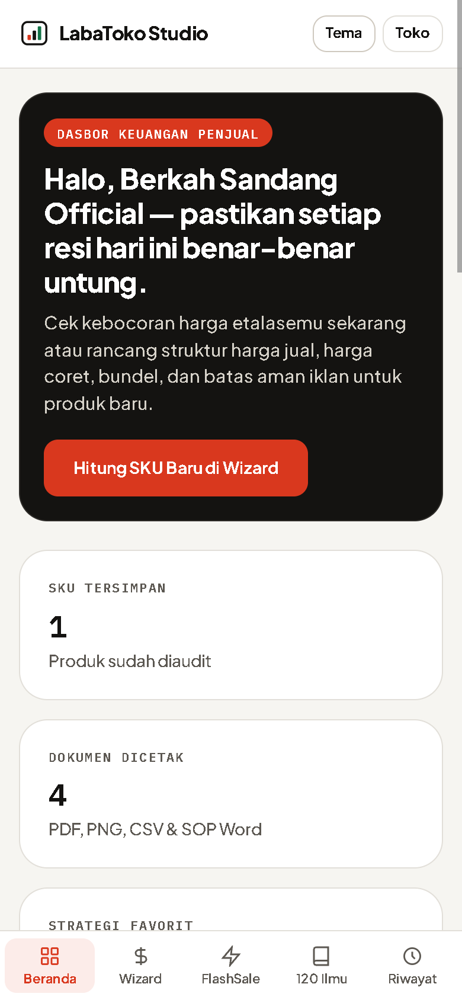

# SETOR PRODUK #7 — LabaToko Studio

## 1. Profil Produk & Usulan Harga
- **Nama Produk:** LabaToko Studio — Kalkulator Untung Toko Online, Paket Bundling & Batas Aman Iklan
- **Siapa Pembelinya:** Pemilik toko online di Shopee, TikTok Shop, Tokopedia, dan Lazada, pelaku UMKM lokal (fesyen, kecantikan, rumah tangga, kuliner kering, aksesoris), reseller/dropshipper, serta tim admin toko & pengiklan harian di Indonesia.
- **Masalah Apa yang Diselesaikan:**
  1. Banyak penjual online menentukan harga jual hanya pakai kira-kira ("HPP dikali dua"), lupa menghitung potongan admin kategori + Gratis Ongkir/Promo Xtra + biaya tetap per resi Rp1.250 + kardus kemasan + cadangan retur COD, sehingga barang laris tapi saldo rekening jalan di tempat.
  2. Banyak seller menyalakan iklan pencarian atau GMV Max tanpa tahu angka pasti **ROAS Impas** dan **ROAS Sehat**, sehingga mengira ROAS 4x sudah untung besar padahal toko diam-diam nombok di setiap pesanan.
  3. Saat kampanye tanggal kembar (9.9 / 11.11 / 12.12) atau Flash Sale, diskon tambahan sering bertumpuk dengan voucher toko, komisi affiliate kreator, dan biaya iklan sekaligus. Daripada mengeluarkan Rp600.000–Rp1.800.000 untuk kursus iklan marketplace yang penuh teori panjang, penjual langsung mendapatkan mesin hitung praktis yang mencetak 4 dokumen resmi pegangan tim admin toko dalam 3 menit.
- **Harga Jual yang Diusulkan:** **Rp 99.000** (sekali bayar untuk akses penuh aplikasi web seumur hidup di seluruh SKU toko, tanpa biaya langganan bulanan & berjalan 100% mandiri di browser tanpa kuota API berbayar).

---

## 2. Link Live (Cloudflare Pages)
- **Link Landing Page (LP Jualan):** [https://nifari-untung-toko-lp.pages.dev](https://nifari-untung-toko-lp.pages.dev)
- **Link Web App (Aplikasi Pembeli):** [https://nifari-untung-toko-app.pages.dev](https://nifari-untung-toko-app.pages.dev)
  - *Cara masuk untuk pembeli & penguji:* Masukkan Kode Akses resmi yang diterima setelah konfirmasi pembelian pada layar masuk, lalu klik **Masuk ke LabaToko Studio** (belum punya kode dapat mencoba kalkulator di Landing Page terlebih dahulu).

---

## 3. Tangkapan Layar Aplikasi (3 Desktop + 1 HP)

### Desktop 1 — Beranda Keuangan Penjual & Pemindai Kebocoran Margin 30 Detik

### Desktop 2 — Wizard Langkah 3: Ringkasan Unit Ekonomi, Audit 8 Titik & Ekspor 4 File Tim Toko

### Desktop 3 — Simulator Anti-Boncos Kampanye Tanggal Kembar & Flash Sale

### Tampilan HP (Lebar 390px) — Navigasi Bawah Rapi, Kartu Bersih & Tanpa Geser Samping

*(Tangkapan layar tambahan juga tersimpan di folder `./screenshots/`: `01-login-desktop.png` untuk Layar Akses Lisensi Pembeli dan `05-pustaka-120-desktop.png` untuk Pustaka 120 Strategi Judul SEO, Konsep 5 Foto, Bundling, SOP Iklan & Skrip Cegah Retur COD).*

---

## 4. Apa yang Sudah Dites & Hasilnya

Seluruh pengujian dijalankan menggunakan browser **Google Chrome asli** pada ukuran layar Desktop (`1366×860`) dan HP (`390×844`):

| Bagian yang Dites | Skenario Pengujian | Hasil |
| :--- | :--- | :--- |
| **Login Lisensi Pembeli** | Masuk memakai nama pemilik, nama toko online, email, & kode akses resmi terverifikasi SHA-256 | **Lulus** — Validasi hash berjalan ketat tanpa bocoran kode di kode sumber, dan sesi tersimpan rapi menyapa nama toko. |
| **Pemindai Kebocoran 30 Detik** | Ubah HPP, harga tayang saat ini, persen admin + Xtra, & biaya iklan per laku 1 pcs lalu kirim ke Wizard | **Lulus** — Potongan rupiah, sisa bersih per pesanan, serta ROAS impas terhitung seketika dan berpindah ke Wizard. |
| **Wizard 3 Langkah (Harga, Bundel & ROAS)** | Pilih 1 dari 8 preset kategori toko → atur harga coret & porsi iklan → periksa 3 paket bundling & audit 8 titik | **Lulus** — Harga tayang aman, tampilan harga coret, 3 paket bundling (1, 2, 3 pcs), ROAS Impas vs ROAS Sehat, dan skor keamanan `100%` terhitung akurat. |
| **Ekspor Audit Margin & ROAS (`.pdf`)** | Klik unduh Lembar Audit Margin & ROAS A4 | **Lulus** — Menghasilkan dokumen PDF A4 multi-bagian asli (`4,9 KB`, header `%PDF-1.4`) berisi rincian unit ekonomi, 3 bundel, & aturan ROAS. |
| **Ekspor Kartu Rambu Admin (`.png`)** | Klik unduh Kartu Rambu Harga Admin | **Lulus** — Menghasilkan gambar tajam `1080×1350 px` (`92,2 KB`, header PNG asli) siap kirim ke WhatsApp tim admin toko. |
| **Ekspor Pelacak 30 Hari (`.csv`) & SOP (`.docx`)** | Klik unduh Tabel Pelacak 30 Hari CSV & Dokumen SOP Promo Word | **Lulus** — Menghasilkan file `.CSV` ber-UTF-8 BOM (`2,6 KB`) siap buka di Excel/Sheets dan dokumen Word OOXML `.DOCX` asli (`5,6 KB`, header ZIP `PK`). |
| **Simulator Anti-Boncos Flash Sale** | Uji skenario tumpukan diskon tinggi (`22%` + affiliate `10%` + iklan) serta skenario kampanye sehat | **Lulus** — Skenario rugi langsung memicu peringatan merah `BAHAYA BONCOS` lengkap nominal tekor per 100 pcs; skenario sehat terdeteksi `AMAN DIIKUTI`. |
| **Pustaka 120 Strategi Toko Online** | Filter 6 kategori ilmu, filter 8 kategori produk, pencarian kata kunci, buka modal detail, simpan favorit, & ganti tema gelap/terang | **Lulus** — Seluruh **120 strategi** tampil utuh lengkap rumus siap salin, langkah eksekusi, dampak margin, favorit, & mode gelap/terang. |
| **Sistem Desain (*Swiss Financial Ledger*)** | Audit palet Warm Alabaster `#F6F5F1`, Pure Paper `#FFFFFF`, Deep Espresso `#141311`, Signal Vermilion `#D9381E`, Profit Emerald `#137347`, sudut kartu `24px`, tanpa gradasi, tanpa *drop-shadow*, & tanpa emoji | **Lulus** — Tampilan bersih, kontras tajam, angka sejajar (*tabular-nums*), dan 0 emoji di seluruh Web App maupun Landing Page. |
| **Landing Page (`< 1 MB`)** | Cek ukuran file tunggal (`569,0 KB`), 12 bagian berurutan, animasi Bedah Margin Pesanan di Hero, & Demo unduh sampel `.PNG` asli | **Lulus** — Ukuran jauh di bawah batas 1 MB, seluruh 5 gambar WebP termuat penuh, kalkulator demo + unduhan PNG, checkout 2 kolom, & FAQ berjalan mulus. |
| **Responsif HP (`390px`) & Console** | Cek `document.documentElement.scrollWidth` di semua layar App & LP serta pantau error console/runtime | **Lulus** — `scrollWidth = 390px` presisi di semua menu tanpa geser samping dan **0 error** di console baik pada Web App maupun Landing Page. |
